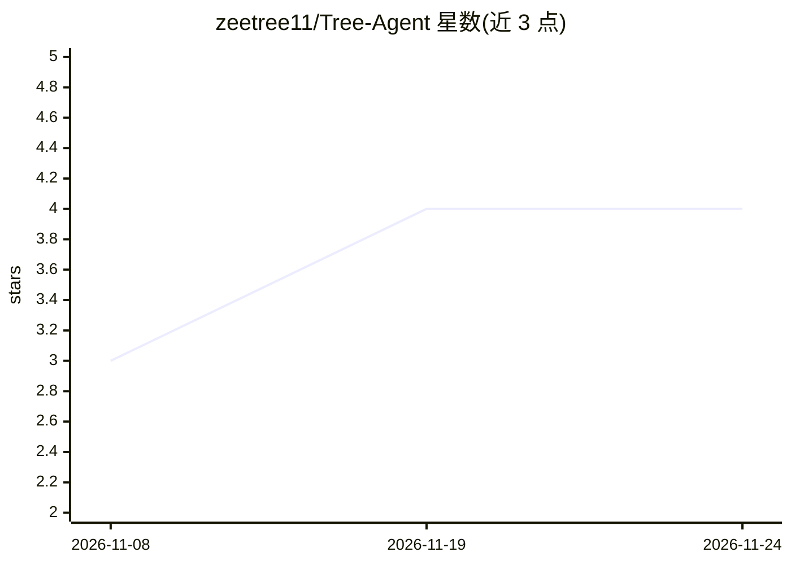

# zeetree11/Tree-Agent

⭐ 4 · TypeScript · MIT · 推送 2026-11-18 · [GitHub](https://github.com/zeetree11/Tree-Agent) · 个人维护 · 中文 README

**基于 pi 编码 agent 封装的个人助理运行时**

在 pi 编码 agent（@earendil-works/pi-coding-agent）之上封装的个人助理运行时，不是 fork 而是把 pi 当内核。提供事件级证据绑定的持久记忆（编号事件+逐字引文校验、四态裁决、tentative 永不注入）、bge-m3 向量检索、滚动摘要与上下文分段预算，接入 CLI/Web/Telegram/飞书/QQ 多通道，同一份记忆；带工具治理（死循环指纹、HITL 审批、SSRF 防护）、记忆抽取评测命令与 token 用量校准。TypeScript 实现，npm 安装，数据库为 SQLite。

## 筛选速览

| 维度 | 判定 | 备注 |
|---|---|---|
| AI 角色 | `ai-native` | 本体是模型或模型工具 |
| 许可风险 | `permissive` | MIT |
| 部署形态 | `self-host` | docker 或自建部署 |
| 模型依赖 | — | README 未给出锁定关系 |
| 硬件要求 | — | 无带数字的原话,不猜 |
| 安装摩擦 | `low` | 无编译、无系统依赖或容器化 |
| 成熟度 | — | 结构信号不足 |

## 能力要点

- 每条记忆绑定编号事件与逐字证据，四态裁决（create/correct/invalidate/contest）由数据库校验
- bge-m3 向量检索 + SQLite 余弦，阈值按模型自适应
- CLI/Web/Telegram/飞书/QQ 多通道接入，幂等去重与消息事件化
- 自带记忆抽取评测（eval）与 token 估算最小二乘校准

## 适用场景

- 在 IM（飞书/QQ/Telegram）里搭一个有长期记忆的个人助理
- 让 agent 记住用户偏好并处理记忆冲突与作废
- 按线程作用域隔离项目事实与个人事实
- 对记忆抽取质量跑可复现的评测基准

## 场景标签

`Agent 记忆` `编码 Agent` `AI 助手` `模型评测` · 领域:Agent 开发

## 证据(README 行号)

> L3: > 个人 Agent 运行时。名字是 Tree-Agent，内核仍然是 **pi**（`@earendil-works/pi-coding-agent`）——
> L7: 一个跑在 **pi** 编码 agent（`@earendil-works/pi-coding-agent`）之上的个人助理运行时 —— 像平台团队封装 agent 内核那样封装它。
> L26: |**通道**|CLI / Web / Telegram / 飞书 / QQ（OneBot v11），同一份记忆|

## 星数曲线

2026-11-08 3 → 2026-11-24 4（+1）

---
*卡片 v1 · prompt 1.4 · 生成 2026-11-21 · 置信度 low · 依据 README sha `14e114bd97e0` · [字段定义](../../DATASET.md)*
