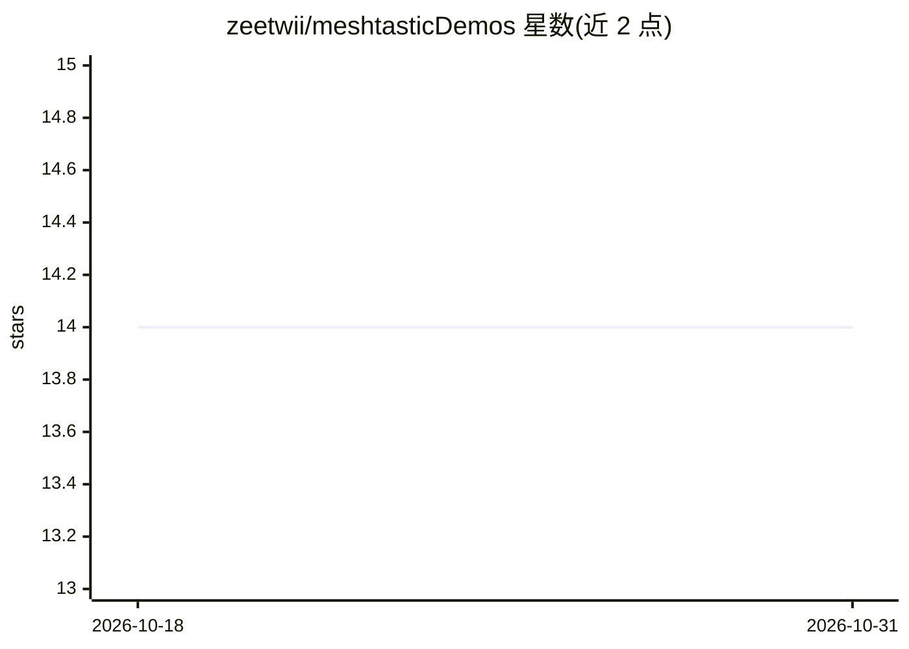

# zeetwii/meshtasticDemos

⭐ 14 · Python · MIT · 推送 2026-06-21 · [GitHub](https://github.com/zeetwii/meshtasticDemos) · 个人维护

**在 Meshtastic 网格上用本地 LLM 操作传感器与设备的项目集**

面向 Meshtastic LoRa 网格的演示脚本集合：在树莓派等设备上通过 Ollama 运行本地 LLM，作为自然语言转换层，让网格上的用户无需事先了解即可查询和操作连接的传感器与系统（作者称为 detraining）。部分演示来自 DEFCON 33 AI Village，另含航班查询（ADS-B）、YOLO 触发拍照并让 LLM 摘要图像、WiFi 网络查询等。需要 Python 3、至少 4GB 可用内存（文本模型 2GB）、USB 串口连接的 Meshtastic 兼容设备（以 Seeed Studio XIAO ESP32S3 测试）。每个项目有独立子目录与 README。

## 筛选速览

| 维度 | 判定 | 备注 |
|---|---|---|
| AI 角色 | `ai-native` | 本体是模型或模型工具 |
| 许可风险 | `permissive` | MIT |
| 部署形态 | `None` |  |
| 模型依赖 | local-ok | 支持本地模型 |
| 硬件要求 | — | 无带数字的原话,不猜 |
| 安装摩擦 | `low` | 无编译、无系统依赖或容器化 |
| 成熟度 | — | 结构信号不足 |

## 能力要点

- 本地 LLM 作为网格传感器交互的自然语言转换层，无需互联网
- 演示包括聊天机器人、ADS-B 航班查询、YOLO 触发拍照并 LLM 摘要、WiFi 网络查询与告警
- 全部演示通过 Ollama 在树莓派上本地运行模型
- 各项目子目录含独立 README 说明设备与配置

## 适用场景

- 在偏远或应急场景的 Meshtastic 网格上以自然语言查询传感器
- 通过网格分享摄像头实时图像的文字摘要
- 了解如何在 LoRa 网格上部署本地 LLM 服务

## 场景标签

`聊天机器人` `目标检测` · 领域:对话与助手

## 证据(README 行号)

> L3: This is a collection of projects and demonstration scripts for using locally running LLMs and other AI models to mak
> L13: However, this adhoc nature presents an interesting challenge for anyone hosting tools or sensors on the mesh, since

## 星数曲线

2026-10-18 14 → 2026-10-31 14（+0）

---
*卡片 v1 · prompt 1.4 · 生成 2026-10-31 · 置信度 high · 依据 README sha `1a2338f25b59` · [字段定义](../../DATASET.md)*
