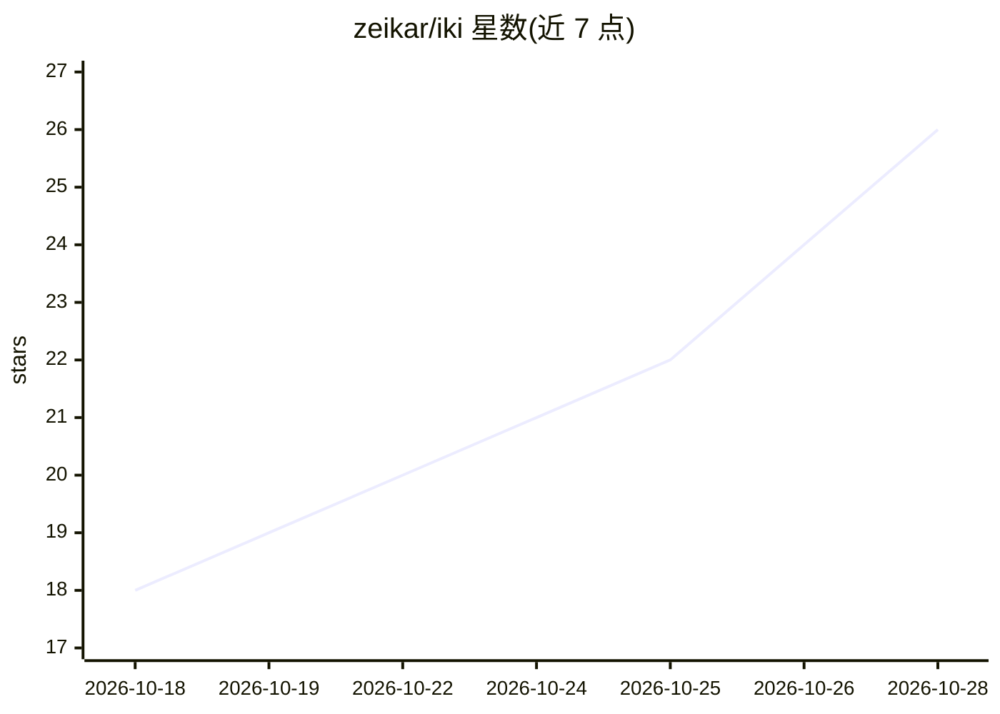

# zeikar/iki

⭐ 26 · TypeScript · MIT · 推送 2026-10-25 · [GitHub](https://github.com/zeikar/iki) · [官网](https://zeikar.dev/iki/) · 个人维护

**面向 Web 的开源 Live2D 替代：MIT 许可的 2D 纸偶引擎，AI 可自动绑定**

MIT 许可的浏览器端 2D 纸偶动画引擎，定位为 Live2D/Inochi2D 的开源替代：模型为明文 JSON 的 .iki 格式，TypeScript + WebGL2 运行时经 npm 安装后在任意浏览器播放。配套 Claude Code / Codex 插件可由 AI 代理绘制部件并自动绑定（眨眼、视线、口型同步、转头、头发物理），或通过 @ikijs/mcp 服务器对已命名的 PNG/PSD 图层自动绑定。提供在线 Playground 与 Editor 演示。项目自述处于早期（0.x，schema 尚在变动）。给 Web 开发者与虚拟形象制作者使用。

## 筛选速览

| 维度 | 判定 | 备注 |
|---|---|---|
| AI 角色 | `ai-enhanced` | 去掉 AI 部分产品仍成立 |
| 许可风险 | `permissive` | MIT |
| 部署形态 | `library` | 以包/库形式分发 |
| 模型依赖 | locked-api |  |
| 硬件要求 | — | 无带数字的原话,不猜 |
| 安装摩擦 | `low` | 无编译、无系统依赖或容器化 |
| 成熟度 | `idea` | |

## 能力要点

- 明文 JSON 的 .iki 开放格式，带文档化 schema 与校验器
- Claude Code / Codex 插件：图像模型绘制部件 + 自动绑定为可动角色
- @ikijs/mcp 服务器向 AI 代理暴露 compose/measure/auto-rig 等工具
- TypeScript + WebGL2 运行时，支持变形网格、模板裁剪、弹簧物理

## 适用场景

- 在网页中播放和驱动 2D 虚拟形象（口型同步、视线、表情）
- 让 AI 代理从文字描述生成一个可动的 .iki 角色
- 把自己的分层美术稿件自动绑定为可动模型
- 作为 Live2D 的 MIT 许可替代方案嵌入虚拟主播等宿主应用

## 场景标签

`图像生成` · 领域:内容生成

## 证据(README 行号)

> L20: **Iki** is a free, MIT-licensed 2D puppet animation engine for the web — an
> L23: Claude Code / Codex plugin has an image model draw its parts, then rigs them
> L63: 3. **Rigs** them (`auto_rig_from_layers`): eyelid-fold blink, gaze, lip-sync,

## 星数曲线

2026-10-18 18 → 2026-10-28 26（+8）

---
*卡片 v1 · prompt 1.4 · 生成 2026-10-27 · 置信度 high · 依据 README sha `8172c2486501` · [字段定义](../../DATASET.md)*
