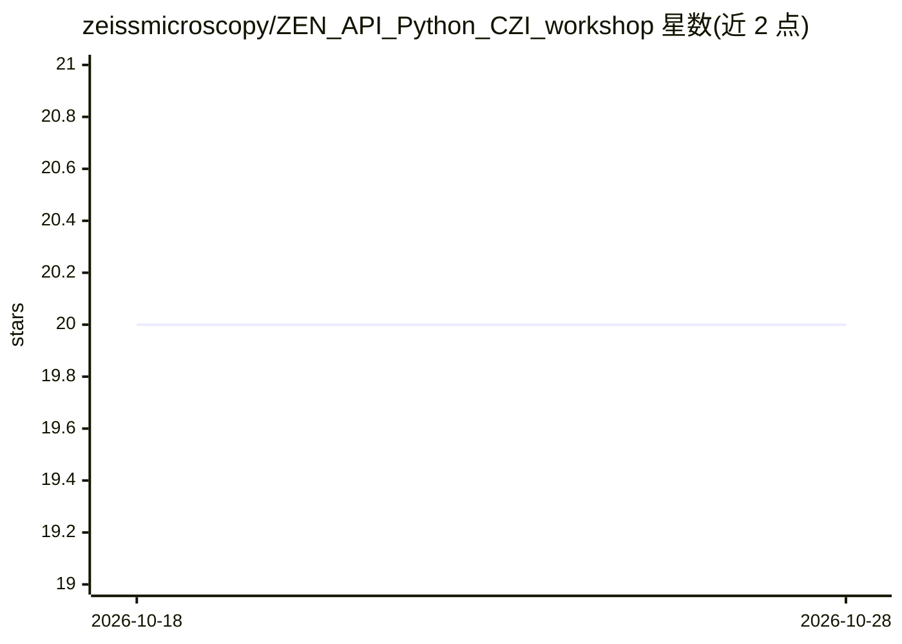

# zeissmicroscopy/ZEN_API_Python_CZI_workshop

⭐ 20 · Jupyter Notebook · GPL-3.0 · 推送 2026-02-25 · [GitHub](https://github.com/zeissmicroscopy/ZEN_API_Python_CZI_workshop) · 组织维护

**ZEN 显微成像与 CZI 文件 Python 工具的现场培训材料库**

Zeiss 显微镜部门维护的智能显微培训仓库，围绕 ZEN 软件、CZI 图像格式与相关 Python 包组织教程、脚本与 Jupyter/Colab 笔记本：涵盖 ZEN API 像素流与引导式采集示例、在 arivis Cloud 上训练语义分割模型并用 czmodel 打包为 .czann 供 ZEN/Napari/自有代码调用、czitools 读写 CZI 元数据与像素数据、CZI 转 OME-ZARR 脚本，并介绍 CZICompress/CZIShrink/CZICheck 等配套工具。README 多处声明内容为纯实验性、不提供担保。

## 筛选速览

| 维度 | 判定 | 备注 |
|---|---|---|
| AI 角色 | `ai-knowledge` | 知识聚合/清单类 |
| 许可风险 | `viral` | GPL-3.0 |
| 部署形态 | `desktop` | 安装包/桌面程序 |
| 模型依赖 | — | README 未给出锁定关系 |
| 硬件要求 | — | 无带数字的原话,不猜 |
| 安装摩擦 | `low` | 无编译、无系统依赖或容器化 |
| 成熟度 | `idea` | |

## 能力要点

- ZEN API 像素流在线处理与引导式自动采集示例
- arivis Cloud 训练语义分割模型，czmodel 将 PyTorch/ONNX 模型转为 .czann 在 ZEN/arivis/Napari 中使用
- czitools 读取 CZI 元数据与像素数据、写出 OME-ZARR
- 配套介绍 CZICompress（ZSTD 压缩 CLI）、CZIShrink（GUI）、CZICheck（完整性校验）工具

## 适用场景

- 学习用 Python 控制 ZEN 显微成像与在线图像处理
- 训练并部署显微图像细胞核分割模型到 ZEN 或 Napari 工作流
- 批量处理 CZI 文件的读取、压缩与 OME-ZARR 转换

## 场景标签

 · 领域:显微成像/生物图像分析

## 证据(README 行号)

> L13: This repository contains scripts and notebooks showcasing several tools and scripts centered around ZEN, CZI image 
> L65: ## Deep Learning Topics
> L67: ### Train a Deep-Learning Model for Semantic Segmentation on arivis Cloud

## 星数曲线

2026-10-18 20 → 2026-10-28 20（+0）

---
*卡片 v1 · prompt 1.4 · 生成 2026-10-28 · 置信度 mid · 依据 README sha `3a0d9f790927` · [字段定义](../../DATASET.md)*
