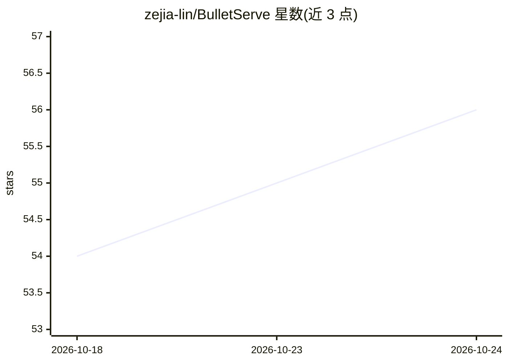

# zejia-lin/BulletServe

⭐ 56 · Python · Apache-2.0 · 推送 2026-09-23 · [GitHub](https://github.com/zejia-lin/BulletServe) · 个人维护

**LLM 推理服务系统：同卡时空共享并发 prefill 与 decode**

BulletServe（Bullet）是面向 LLM serving 的系统，通过单设备内 prefill 与 decode 阶段的细粒度时空 GPU 共享实现两阶段并发执行，以提升吞吐与 GPU 利用率。机制上基于 libsmctrl 做 SM 级计算单元划分、依赖 NVIDIA MPS 做空间共享，以 SGLang fork 形式提供，通过 --enable-bullet-engine 标志启用。需自行编译 libsmctrl（make config/build），要求 CUDA <= 12.6、Python >= 3.12.9。作者声明其为研究原型，与开源 SGLang 功能不完全对齐，仅保留关键功能。论文被 ASPLOS 2026 接收。

## 筛选速览

| 维度 | 判定 | 备注 |
|---|---|---|
| AI 角色 | `ai-ecosystem` | LLM/agent 周边工具 |
| 许可风险 | `permissive` | Apache-2.0 |
| 部署形态 | `None` |  |
| 模型依赖 | — | README 未给出锁定关系 |
| 硬件要求 | — | 无带数字的原话,不猜 |
| 安装摩擦 | `medium` | 含编译或系统依赖之一 |
| 成熟度 | `idea` | |

## 能力要点

- prefill 与 decode 在同一设备上并发执行的设备内分离（intra-device disaggregation）
- 基于 libsmctrl 的 SM 掩码实现细粒度计算单元划分
- 动态计算资源供给，针对吞吐-延迟权衡
- 以 SGLang fork 形式提供，--enable-bullet-engine 启用

## 适用场景

- 提升 LLM 推理服务的 GPU 利用率与吞吐
- 在同一 GPU 上并发运行 prefill 与 decode 实例
- 研究 LLM serving 的时空资源编排方法

## 场景标签

`推理引擎` · 领域:训练与推理

## 证据(README 行号)

> L8: BulletServe is a novel LLM serving system that enables concurrent execution of prefill and decode phases on the same
> L71: python -m sglang.launch_server --model-path /path/to/model --disable-radix-cache --enable-bullet-engine
> L110: This repository originally started as a fork of SGLang. Bullet is research prototype and do not have complete feat

## 星数曲线

2026-10-18 54 → 2026-10-24 56（+2）

---
*卡片 v1 · prompt 1.4 · 生成 2026-10-24 · 置信度 high · 依据 README sha `f38404f7dc9c` · [字段定义](../../DATASET.md)*
