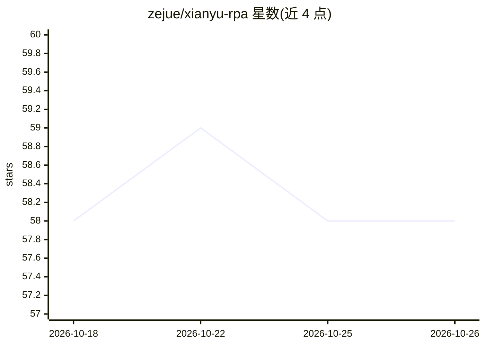

# zejue/xianyu-rpa

⭐ 58 · HTML · 推送 2026-08-21 · [GitHub](https://github.com/zejue/xianyu-rpa) · [官网](https://zejue.github.io/xianyu-rpa/) · 个人维护 · 中文 README

**闲鱼卖家的本地化 RPA 运营工具：多店铺接待、自动发货与 AI 客服**

面向闲鱼卖家的桌面自动化运营工具，以本地部署方式运行：多店铺聚合接待（多网点多设备消息统一处理）、自动发货（文本/图片/卡密/第三方 API）、关键词与 AI 自动回复、自动评价催收货、商品同步发布与 AI 文案优化、经营数据复盘。使用需获取激活码，下载压缩包与主程序 exe 双击运行挂机；数据全部本地存储。声明仅用于卖家经营效率辅助与学习交流。

## 筛选速览

| 维度 | 判定 | 备注 |
|---|---|---|
| AI 角色 | `ai-enhanced` | 去掉 AI 部分产品仍成立 |
| 许可风险 | `none` | — |
| 部署形态 | `None` |  |
| 模型依赖 | — | README 未给出锁定关系 |
| 硬件要求 | — | 无带数字的原话,不猜 |
| 安装摩擦 | `low` | 无编译、无系统依赖或容器化 |
| 成熟度 | — | 结构信号不足 |

## 能力要点

- 多店铺/多网点聚合接待，自动同步历史会话
- 自动发货支持固定文本、图片、卡密与第三方 API 接口
- 关键词 + 网点级/商品级 AI 自动回复
- 聊天、交易、商品数据全部本地存储

## 适用场景

- 多店铺闲鱼卖家统一接待买家消息
- 虚拟商品下单后自动发货与订单查漏补缺
- 自动回复买家咨询并自动好评催收货

## 场景标签

`浏览器自动化` · 领域:效率与自动化

## 证据(README 行号)

> L62: |自动回复|关键词回复 + 网点级 AI 回复 + 商品级 AI 回复，秒级响应买家咨询|
> L71: |货源同步|一键同步指定卖家的多个宝贝，支持 **AI 智能文案优化** 提升曝光|

## 星数曲线

2026-10-18 58 → 2026-10-26 58（+0）

---
*卡片 v1 · prompt 1.4 · 生成 2026-10-24 · 置信度 mid · 依据 README sha `5cb376026000` · [字段定义](../../DATASET.md)*
