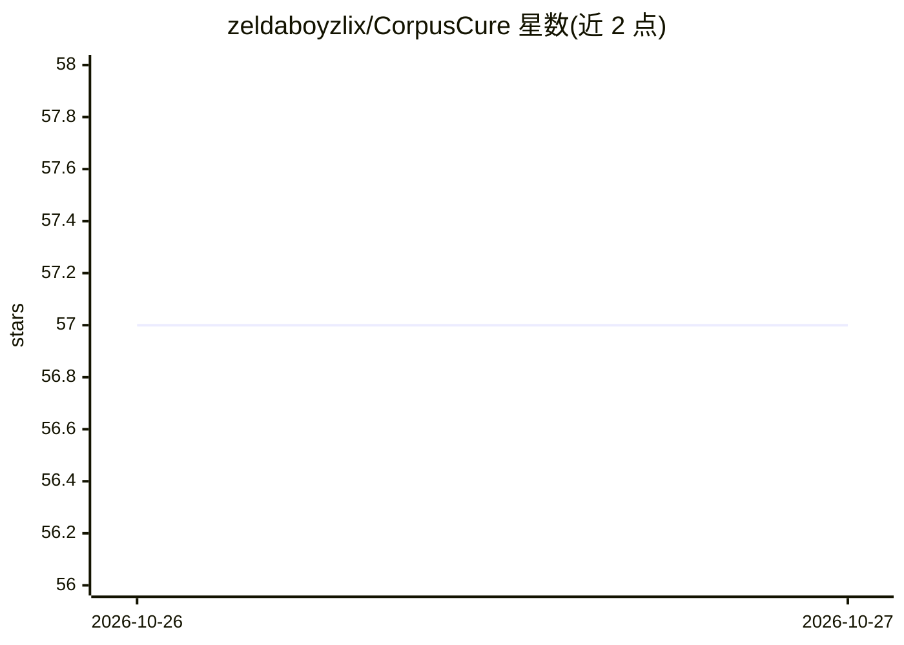

# zeldaboyzlix/CorpusCure

⭐ 57 · Python · MIT · 推送 2026-10-26 · [GitHub](https://github.com/zeldaboyzlix/CorpusCure) · 个人维护

**RAG 语料库诊断工具：检测注入、过期、重复等问题并打分**

面向检索增强生成（RAG）语料库的数据质量检查工具，由两个组件构成：Python 审计器 corpuscure 解析文档并分块后运行五项启发式检测（提示注入签名、基于 front-matter 日期的过期检测、基于 Jaccard 重叠与非对称否定的矛盾候选、权威声明与溯源元数据交叉核验、过小块与内容指纹重复检测），按严重度扣分输出健康分与分级，可用作 CI 门禁；Go 扫描器 corpusscan 并发遍历目录做 SHA-256 哈希找字节级重复并生成清单。两者均零第三方依赖，纯标准库与 Go 工具链，输出确定性、每条发现带证据片段。

## 筛选速览

| 维度 | 判定 | 备注 |
|---|---|---|
| AI 角色 | `ai-ecosystem` | LLM/agent 周边工具 |
| 许可风险 | `permissive` | MIT |
| 部署形态 | `None` |  |
| 模型依赖 | — | README 未给出锁定关系 |
| 硬件要求 | — | 无带数字的原话,不猜 |
| 安装摩擦 | `low` | 无编译、无系统依赖或容器化 |
| 成熟度 | — | 结构信号不足 |

## 能力要点

- 五项启发式检测：注入/过期/矛盾/权威/可达性，输出健康分与 CI 退出码
- Go 扫描器 SHA-256 并发哈希查找字节级重复，64 KiB 流式处理大文件
- Python 部分纯标准库、Go 部分仅用工具链，无任何第三方依赖
- JSON 报告输出与 --fail-under 阈值门禁，可作 Python 库调用

## 适用场景

- RAG 语料入库前检测提示注入与过期文档
- CI 流水线中用健康分阈值拦截不合格语料
- 找出语料库中重复与不可检索的死块以精简索引

## 场景标签

 · 领域:RAG 数据质量/数据工程

## 证据(README 行号)

> L12: A retrieval-augmented generation system is only as trustworthy as the corpus it
> L29: |`corpuscure`|Python 3.10+|Reads documents, runs five diagnostic assays, emits a health-scored report.|
> L255: python -m corpuscure audit ./corpus --format json --output report.json --fail-under 70

## 星数曲线

2026-10-26 57 → 2026-10-27 57（+0）

---
*卡片 v1 · prompt 1.4 · 生成 2026-10-27 · 置信度 high · 依据 README sha `7e80521441e4` · [字段定义](../../DATASET.md)*
