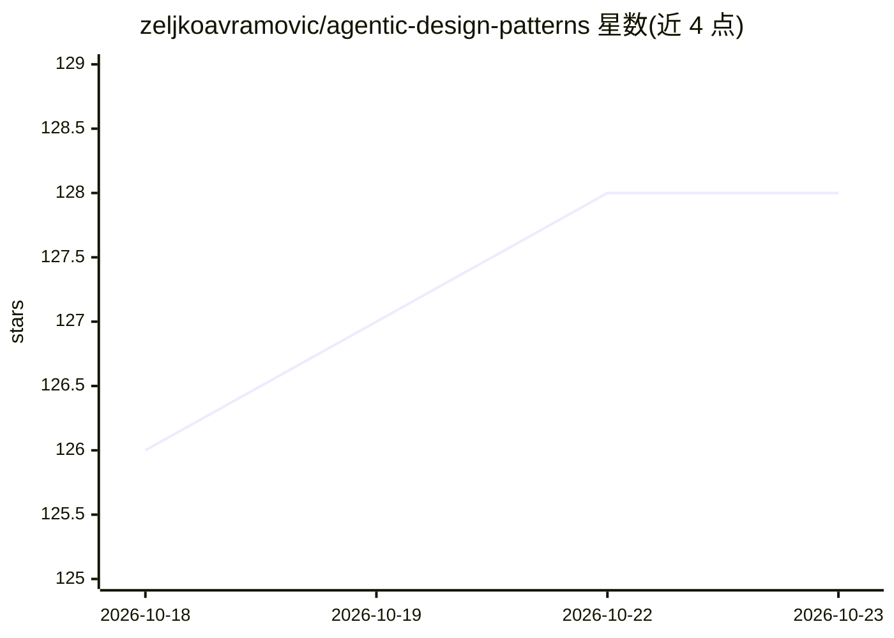

# zeljkoavramovic/agentic-design-patterns

⭐ 128 · HTML · 推送 2026-05-26 · [GitHub](https://github.com/zeljkoavramovic/agentic-design-patterns) · [官网](https://zeljkoavramovic.github.io/agentic-design-patterns/) · 个人维护

**29 种 agentic 设计模式的单文件交互式教程与参考**

一个自包含的单文件（index.html）交互式教程：以可视化图表、详细解释和真实案例讲解构建 AI agent 系统的 29 种设计模式，分为核心模式（Prompt Chaining、Tool Use 等）、推理与策略、编排、基础设施与状态（MCP、RAG）、可靠性与控制（Guardrails、Human-in-the-Loop）等类别。包含模式关系图、模式条目与案例研究；可在线使用或下载后离线在浏览器打开。模式内容整理自公开研究与社区资料。

## 筛选速览

| 维度 | 判定 | 备注 |
|---|---|---|
| AI 角色 | `ai-knowledge` | 知识聚合/清单类 |
| 许可风险 | `none` | — |
| 部署形态 | `None` |  |
| 模型依赖 | — | README 未给出锁定关系 |
| 硬件要求 | — | 无带数字的原话,不猜 |
| 安装摩擦 | `low` | 无编译、无系统依赖或容器化 |
| 成熟度 | — | 结构信号不足 |

## 能力要点

- 单文件包含概览页、模式关系图、29 个模式条目与案例研究
- 模式按核心/推理策略/编排/基础设施状态/可靠性控制分组
- 支持在线访问与离线下载使用

## 适用场景

- 学习 agentic AI 系统的常用架构模式
- 为 agent 系统设计选型时查阅模式关系与案例
- 离线环境作为设计模式速查参考

## 场景标签

 · 领域:AI/知识参考

## 证据(README 行号)

> L3: This repository contains an interactive, single-file tutorial on essential agentic design patterns for building inte
> L32: The tutorial covers the following 29 patterns, grouped into categories:

## 星数曲线

2026-10-18 126 → 2026-10-23 128（+2）

---
*卡片 v1 · prompt 1.4 · 生成 2026-10-22 · 置信度 high · 依据 README sha `25e0c0b71d3b` · [字段定义](../../DATASET.md)*
