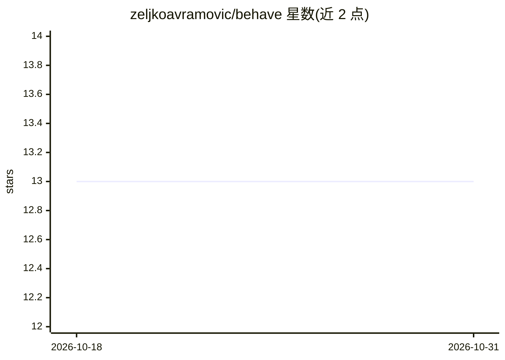

# zeljkoavramovic/behave

⭐ 13 · Python · 推送 2026-09-30 · [GitHub](https://github.com/zeljkoavramovic/behave) · [官网](https://zeljkoavramovic.github.io/behave/) · 个人维护

**给 AI 编码 agent 注入行为准则的单文件指令包**

Behave 是一份零依赖的 Markdown 指令文件（BEHAVE.md）加一个仅用标准库的跨平台 Python 安装器（install.py）。安装器自动检测本机已装的 AI 编码 agent，将行为准则写入其规则目录或注入 CLAUDE.md/AGENTS.md/GEMINI.md，支持全局或项目级安装。准则内容源自 Karpathy 对 LLM 编码陷阱的观察与 Bernstein 的协作工作协议，包含四条核心原则、三种操作模式、Must/Should/May 措辞约定、硬停止与授权门、按任务类型的验证要求及结构化任务后报告。官方称支持 52 种 agent，语言/框架/OS 无关。

## 筛选速览

| 维度 | 判定 | 备注 |
|---|---|---|
| AI 角色 | `ai-ecosystem` | LLM/agent 周边工具 |
| 许可风险 | `none` | — |
| 部署形态 | `None` |  |
| 模型依赖 | — | README 未给出锁定关系 |
| 硬件要求 | — | 无带数字的原话,不猜 |
| 安装摩擦 | `low` | 无编译、无系统依赖或容器化 |
| 成熟度 | — | 结构信号不足 |

## 能力要点

- 单文件零依赖，install.py 仅用 Python 标准库，支持 Windows/Linux/macOS
- 自动检测已安装 agent，支持全局或项目级安装与三种写入模式（inline/drop/copy）
- 行为准则含硬停止规则引用、授权门、按任务类型验证与结构化任务后报告
- 官方列出 52 个受支持 agent（Claude Code、Codex、Cursor 等）

## 适用场景

- 让我的 AI 编码 agent 在大项目中保持小步修改、不做未要求的重构
- 在 agent 执行破坏性命令或改动密钥前强制停机并请求授权
- 统一多个编码 agent 的行为规则，避免各写各的提示词

## 场景标签

`提示工程` · 领域:Agent 开发

## 证据(README 行号)

> L9: If you've made nice little projects with your AI coding agents but watched bigger ones collapse into unmaintainable 
> L15: **Behave** supports **Claude Code**, **Codex**, **Cursor**, **OpenCode**, **Kilo Code**, **Cline**, **Antigravity**
> L147: The repo ships two files. `BEHAVE.md` is the instructions file itself - pure Markdown, zero dependencies - and `in

## 星数曲线

2026-10-18 13 → 2026-10-31 13（+0）

---
*卡片 v1 · prompt 1.4 · 生成 2026-10-31 · 置信度 high · 依据 README sha `721b626aafeb` · [字段定义](../../DATASET.md)*
