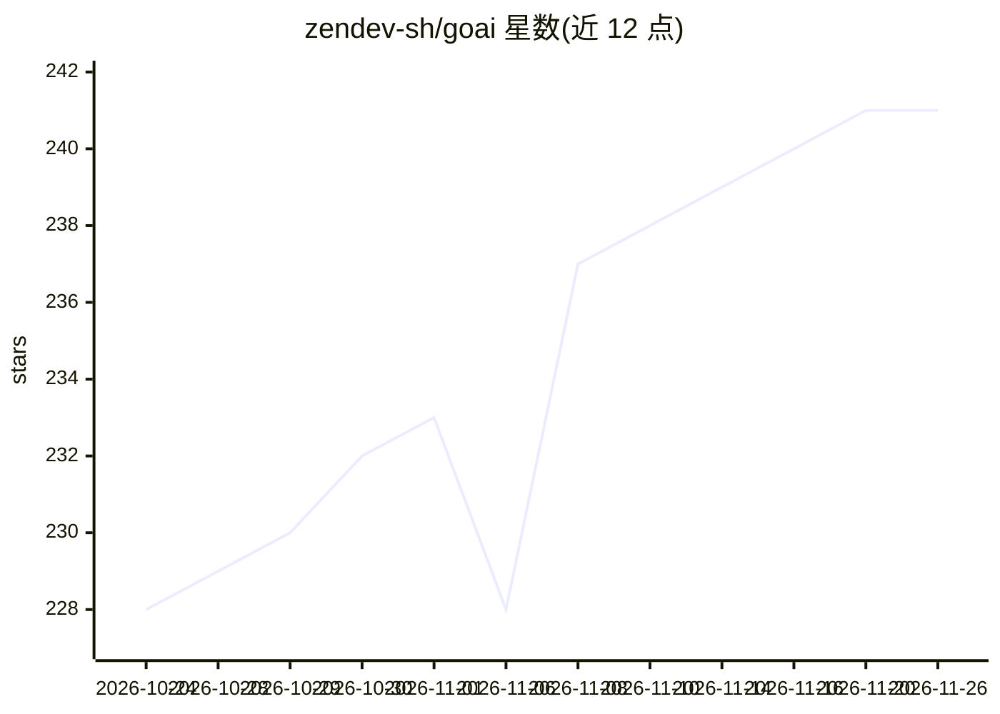

# zendev-sh/goai

⭐ 241 · Go · MIT · 推送 2026-11-08 · [GitHub](https://github.com/zendev-sh/goai) · [官网](https://goai.sh/) · 个人维护

**Go 开发者的统一 AI SDK：一套 API 接入 25+ 提供商**

面向 Go 开发者的 AI 应用 SDK，受 Vercel AI SDK 启发。提供 8 个核心函数（文本/对象生成、流式、嵌入、图像、视频生成）、自动工具循环、从 Go 类型反射生成 JSON Schema 的结构化输出、MCP 客户端（stdio/HTTP/SSE 及 OAuth+PKCE）、Langfuse 与 OpenTelemetry 集成、10 个生命周期钩子与重试机制。核心仅依赖 golang.org/x/oauth2 与 coder/websocket。安装需 Go 1.25+，通过 go get 获取。

## 筛选速览

| 维度 | 判定 | 备注 |
|---|---|---|
| AI 角色 | `ai-ecosystem` | LLM/agent 周边工具 |
| 许可风险 | `permissive` | MIT |
| 部署形态 | `None` |  |
| 模型依赖 | local-ok | 支持本地模型 |
| 硬件要求 | — | 无带数字的原话,不猜 |
| 安装摩擦 | `low` | 无编译、无系统依赖或容器化 |
| 成熟度 | `idea` | |

## 能力要点

- 25+ 提供商统一 API，含 OpenAI/Anthropic/Google/Bedrock/Ollama/vLLM 等
- GenerateObject[T] 经反射从 Go 类型自动生成 JSON Schema
- MCP 客户端支持 stdio/HTTP/SSE 与 OAuth 2.1+PKCE 远程服务器
- 8 个核心函数覆盖文本、流式、嵌入、图像与视频生成

## 适用场景

- 在 Go 后端中接入多家 LLM 提供商并统一调用接口
- 用类型化工具定义构建带自动工具循环的 Agent
- 为生成链路接入 Langfuse/OpenTelemetry 追踪

## 场景标签

`模型网关` · 领域:Agent 开发

## 证据(README 行号)

> L6:  Go SDK for building AI applications. One SDK, 25+ providers, MCP support.
> L37: - **8 core functions**: `GenerateText`, `StreamText`, `GenerateObject[T]`, `StreamObject[T]`, `Embed`, `EmbedMany`,
> L49: - **MCP client**: Connect to any MCP server (stdio, HTTP, SSE), auto-convert tools for use with GoAI

## 星数曲线

2026-10-24 228 → 2026-11-26 241（+13）

---
*卡片 v1 · prompt 1.4 · 生成 2026-11-25 · 置信度 high · 依据 README sha `22bdd630d7f2` · [字段定义](../../DATASET.md)*
