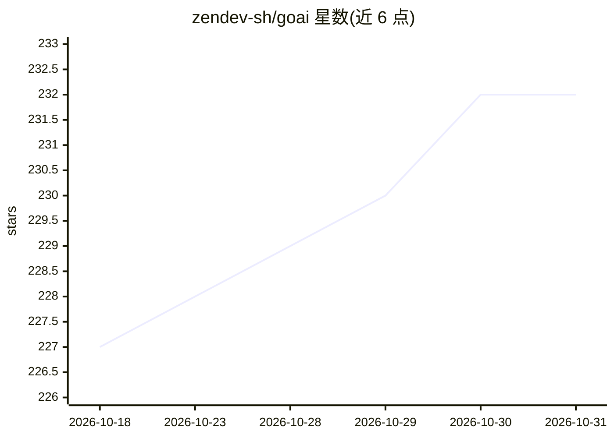

# zendev-sh/goai

⭐ 232 · Go · MIT · 推送 2026-10-27 · [GitHub](https://github.com/zendev-sh/goai) · [官网](https://goai.sh/) · 组织维护

**Go 语言 AI 应用开发 SDK，统一接口接入 25+ 模型提供商**

用 Go 构建 AI 应用的 SDK，受 Vercel AI SDK 启发，以泛型、接口与函数式选项做惯用化适配。提供 8 个核心函数（GenerateText/StreamText/GenerateObject/Embed/GenerateImage/GenerateVideo 等）接入 25+ 提供商，含 MCP 客户端（stdio/HTTP/SSE，OAuth 2.1+PKCE）、自动工具循环、结构化输出（由 Go 类型反射生成 JSON Schema）、流式输出、内置 Langfuse/OpenTelemetry 观测与 10 个生命周期钩子。核心仅依赖 golang.org/x/oauth2 与 coder/websocket，要求 Go 1.25+。README 附与 Vercel AI SDK 的基准对比数据。

## 筛选速览

| 维度 | 判定 | 备注 |
|---|---|---|
| AI 角色 | `ai-ecosystem` | LLM/agent 周边工具 |
| 许可风险 | `permissive` | MIT |
| 部署形态 | `None` |  |
| 模型依赖 | local-ok | 支持本地模型 |
| 硬件要求 | — | 无带数字的原话,不猜 |
| 安装摩擦 | `low` | 无编译、无系统依赖或容器化 |
| 成熟度 | `idea` | |

## 能力要点

- 8 个核心函数覆盖文本/对象生成、流式、嵌入、图像与视频生成
- 25+ 提供商统一 API，含 Ollama/vLLM/llama.cpp 本地运行时
- MCP 客户端支持 stdio/HTTP/SSE 及 OAuth 2.1+PKCE 远程服务器
- GenerateObject[T] 由 Go 类型反射自动生成 JSON Schema
- 内置 Langfuse/OpenTelemetry 观测与 10 个生命周期钩子

## 适用场景

- 在 Go 服务中统一调用多家 LLM 提供商并做流式/结构化输出
- 构建带工具循环与 MCP 工具的 AI agent
- 为 LLM 调用链接入 tracing 与工具执行权限控制

## 场景标签

`模型网关` `Agent 框架` · 领域:Agent 开发

## 证据(README 行号)

> L6:  Go SDK for building AI applications. One SDK, 25+ providers, MCP support.
> L38: - **25+ providers**: OpenAI, Anthropic, Google, Bedrock, Azure, Vertex, Mistral, xAI, Groq, Cohere, DeepSeek, MiniM
> L71: go get github.com/zendev-sh/goai@latest

## 星数曲线

2026-10-18 227 → 2026-10-31 232（+5）

---
*卡片 v1 · prompt 1.4 · 生成 2026-10-22 · 置信度 high · 依据 README sha `efe7c2eda95f` · [字段定义](../../DATASET.md)*
