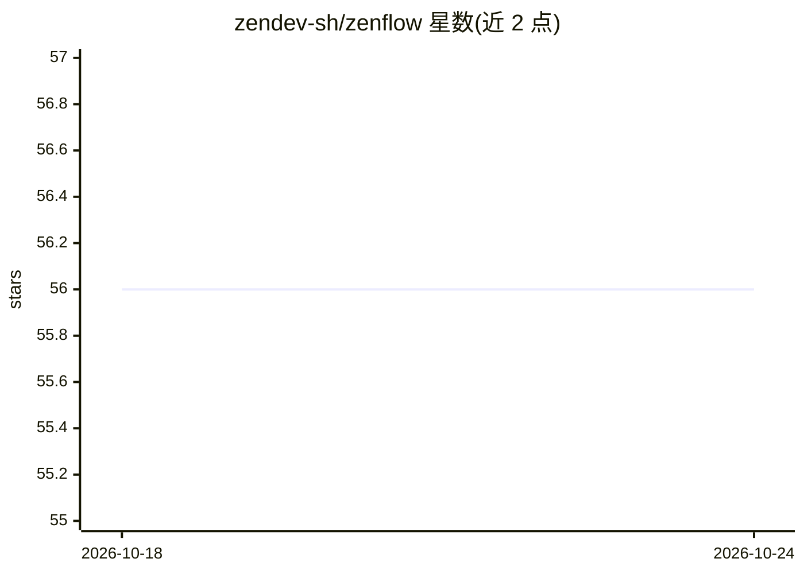

# zendev-sh/zenflow

⭐ 56 · Go · Apache-2.0 · 推送 2026-09-04 · [GitHub](https://github.com/zendev-sh/zenflow) · [官网](https://zenflow.sh) · 组织维护

**多 agent 编排与工作流引擎：YAML 声明式 DAG + LLM 协调者**

以单个 Go 二进制提供的多 agent 编排框架：用声明式 YAML 定义步骤、依赖、并行、CEL 条件、循环与子工作流；LLM 协调者通过 hub-and-spoke 邮箱路由事件，消息按 race-safe 方式投递且带显式丢弃原因；agent 可调用原生 MCP 工具（stdio/HTTP/SSE）。工作流在首次 LLM 调用前先经 schema 校验。提供 CLI 三种模式（flow/goal/agent）与 Go 库嵌入接口，可在 goai 支持的任意 provider 上运行。项目自称 extremely new，v1.0 前 API 与 YAML schema 可能变化。

## 筛选速览

| 维度 | 判定 | 备注 |
|---|---|---|
| AI 角色 | `ai-ecosystem` | LLM/agent 周边工具 |
| 许可风险 | `permissive` | Apache-2.0 |
| 部署形态 | `self-host` | docker 或自建部署 |
| 模型依赖 | locked-api |  |
| 硬件要求 | — | 无带数字的原话,不猜 |
| 安装摩擦 | `low` | 无编译、无系统依赖或容器化 |
| 成熟度 | `idea` | |

## 能力要点

- 声明式 YAML 工作流：依赖、并行、CEL 条件、循环、子工作流 include
- LLM 协调者 + 每消息邮箱的 race-safe 投递与显式丢弃原因
- 原生 MCP 工具接入（stdio/HTTP/SSE），无需改 Go 代码
- 单一静态 Go 二进制，可 CLI 运行或作为 Go 库嵌入（49 个 With* 选项）

## 适用场景

- 用 YAML 声明固定 DAG 的多 agent 工作流并确定性执行
- 让协调者按目标动态规划并运行自适应工作流
- 在 Go 服务中嵌入多 agent 编排能力
- 为 agent 接入任意 MCP server 的工具

## 场景标签

`多智能体` · 领域:Agent 开发

## 证据(README 行号)

> L5:  The multi-agent harness & workflow engine.
> L7:  A production multi-agent harness. Declarative YAML agent workflows; an LLM coordinator routes events through hub-an
> L40: - **Embed anywhere.** CLI for one-shot runs (`zenflow flow`, `zenflow goal`, `zenflow agent`); Go library primitive

## 星数曲线

2026-10-18 56 → 2026-10-24 56（+0）

---
*卡片 v1 · prompt 1.4 · 生成 2026-10-24 · 置信度 high · 依据 README sha `e8cf1c7a6c22` · [字段定义](../../DATASET.md)*
