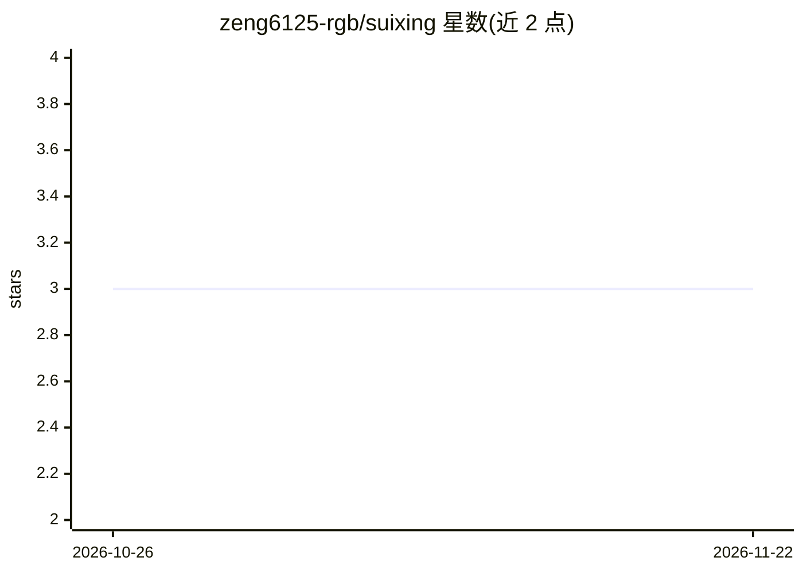

# zeng6125-rgb/suixing

⭐ — · [GitHub]() · 个人维护 · 中文 README

**Android 手机端本地 AI Agent：读屏、点按、改文件、跑命令**

基于 Kotlin + Jetpack Compose 的 Android 应用，接入 OpenAI 兼容接口（另支持 Anthropic Messages 与 OpenAI Responses 协议）驱动手机上的 Agent：内置读屏、点按、文件编辑、Shell、定时提醒等约 70 个工具，支持 MCP 外挂工具、SKILL.md 技能与 zip 插件扩展。数据全部留在本机，无云同步与遥测，API Key 存私有目录。面向 Android 8.0+ 设备；虚拟屏与 PRoot 环境部分依赖 root 或无障碍权限。

## 筛选速览

| 维度 | 判定 | 备注 |
|---|---|---|
| AI 角色 | `ai-native` | 本体是模型或模型工具 |
| 许可风险 | `permissive` | — |
| 部署形态 | `None` |  |
| 模型依赖 | local-ok | 支持本地模型 |
| 硬件要求 | — | 无带数字的原话,不猜 |
| 安装摩擦 | `high` | 编译与系统依赖俱全 |
| 成熟度 | `idea` | |

## 能力要点

- 读屏与手势自动化（ui_dump/ui_tap/ui_swipe 等）加虚拟屏隔离运行
- MCP（stdio/http）、技能、插件三种扩展机制
- 三档工具审批与敏感数据落盘脱敏
- 随包 bash 终端，四个 ABI，无需另装 Termux

## 适用场景

- 让 AI 代替我完成手机上的日常操作（签到、改设置、整理文件）
- 纯本地运行，API Key 不出本机
- 接入我自己的 DeepSeek/Ollama 接口做手机助手
- 给模型挂 MCP 服务器扩展工具能力

## 场景标签

`GUI 自动化` `AI 助手` · 领域:效率与自动化

## 证据(README 行号)

> L3: 手机端的 AI Agent。给它一个 OpenAI 兼容的模型接口，它就能读你的屏幕、点你的手机、改你的文件、跑你的命令、按时提醒你。
> L97: 内置工具由 ToolRegistry 注册，分组由工具包自己声明。下表列出当前内置工具；实际可用列表还会随助手禁用项、MCP 和插件变化，可在应用的工具页查看。

## 星数曲线

2026-10-26 3 → 2026-11-22 3（+0）

---
*卡片 v1 · prompt 1.4 · 生成 2026-11-22 · 置信度 high · 依据 README sha `04eb1f126d40` · [字段定义](../../DATASET.md)*
