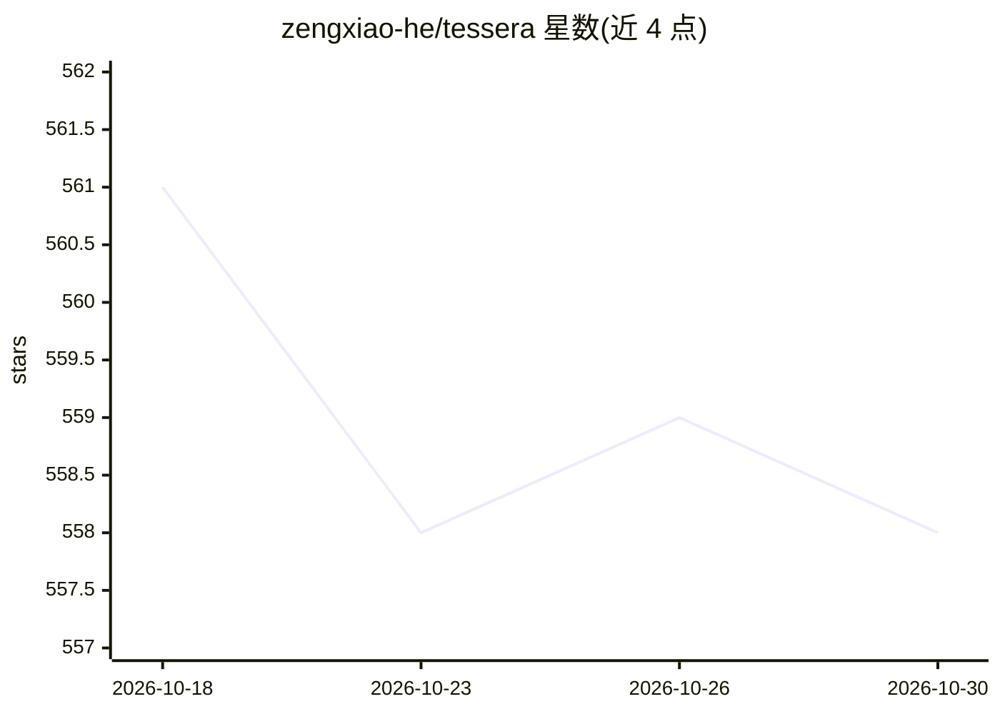

# zengxiao-he/tessera

⭐ 558 · Python · NOASSERTION · 推送 2026-10-09 · [GitHub](https://github.com/zengxiao-he/tessera) · 个人维护

**从零实现的 LLM 蒸馏与推理服务引擎（训练+内核+服务端）**

端到端的小型 LLM 技术栈：将 40M 教师模型经 FSDP/ZeRO-3 蒸馏为 6M 学生模型，再通过自研推理引擎提供服务。包含 Triton/CUDA 手写内核（FlashAttention、融合 RMSNorm、int8 量化矩阵乘）、分块分页 KV 缓存、连续批处理调度器、投机解码（int8/AWQ/FP8 量化），以及 PyO3 桥接 Python 引擎的 Rust HTTP 网关（tokio+axum）。附带 JAX 前向校验实现与可解释性工具（logit lens、induction head 检测）。可在笔记本 CPU 或 Apple MPS 上运行与测试，非 NVIDIA GPU 时内核回退到 torch 参考实现。

## 筛选速览

| 维度 | 判定 | 备注 |
|---|---|---|
| AI 角色 | `ai-ecosystem` | LLM/agent 周边工具 |
| 许可风险 | `none` | NOASSERTION |
| 部署形态 | `library` | 以包/库形式分发 |
| 模型依赖 | — | README 未给出锁定关系 |
| 硬件要求 | — | 无带数字的原话,不猜 |
| 安装摩擦 | `medium` | 含编译或系统依赖之一 |
| 成熟度 | — | 结构信号不足 |

## 能力要点

- 从零实现的 FSDP/ZeRO-3 分片训练，与单进程训练数值一致
- Triton FlashAttention 内核（在线 softmax、GQA、自动调优）
- 分页 KV 缓存 + 连续批处理调度 + 投机解码
- Rust 网关（tokio/axum）经 PyO3 调用 Python 引擎

## 适用场景

- 学习/研究 LLM 训练、内核与服务端各环节的完整实现
- 在小规模模型上做知识蒸馏实验并本地部署推理
- 验证自研算子与参考实现的一致性（含 JAX 奇偶校验）

## 场景标签

`推理引擎` `模型量化` `模型训练` · 领域:训练与推理

## 证据(README 行号)

> L3: A small, from-scratch LLM stack built around one goal: distill a large teacher into a small
> L41: - Block-paged KV cache with a ref-counted allocator for prefix sharing (`serve/paged_kv.py`).
> L45: - A Rust gateway (tokio + axum) that handles HTTP and admission back-pressure and calls into the Python engine over

## 星数曲线

2026-10-18 561 → 2026-10-30 558（-3）

---
*卡片 v1 · prompt 1.4 · 生成 2026-10-21 · 置信度 mid · 依据 README sha `353e5c5b22fc` · [字段定义](../../DATASET.md)*
