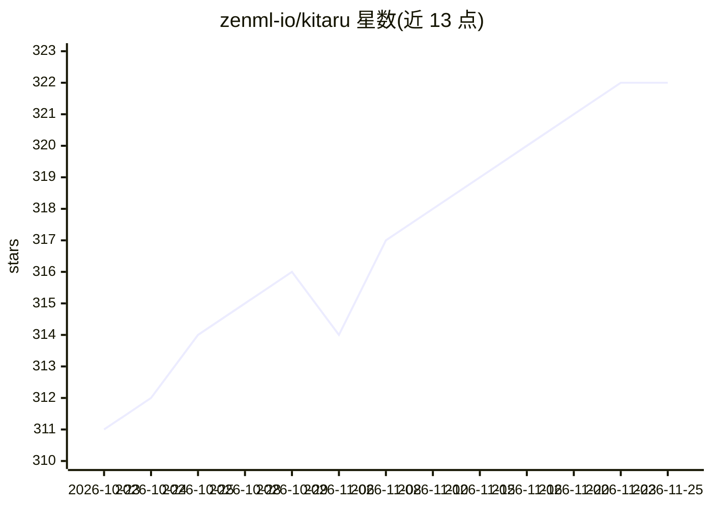

# zenml-io/kitaru

⭐ 322 · Python · Apache-2.0 · 推送 2026-11-23 · [GitHub](https://github.com/zenml-io/kitaru) · [官网](https://kitaru.ai) · 组织维护

**Agent 评测洞察工具：从 trace 中发现模式并回放验证修复**

面向 agent 开发者的评测与可观测性工具：导入已有的 trace（Langfuse、LangSmith、Braintrust、Logfire、Arize Phoenix、MLflow 等）或用 adapter 录制新运行，内置分析器跨全部会话找出失败模式；发现的问题可固化为 evaluator 形成回归检查，修改后对失败会话进行回放对比实验。提供 Python 与 TypeScript SDK、MCP server 与 coding-agent skills，本地自托管（Docker/Helm）或托管云两种服务端。

## 筛选速览

| 维度 | 判定 | 备注 |
|---|---|---|
| AI 角色 | `ai-ecosystem` | LLM/agent 周边工具 |
| 许可风险 | `permissive` | Apache-2.0 |
| 部署形态 | `library` | 以包/库形式分发 |
| 模型依赖 | — | README 未给出锁定关系 |
| 硬件要求 | — | 无带数字的原话,不猜 |
| 安装摩擦 | `low` | 无编译、无系统依赖或容器化 |
| 成熟度 | — | 结构信号不足 |

## 能力要点

- 从既有 trace 存储导入或 adapter 录制，trace 存储保持为系统记录
- 内置确定性分析器无需模型或 API key
- insight→check→replay 四步闭环，回放时工具调用从录制应答
- 为 Claude Code/Codex/Cursor/Windsurf 安装 skills 并注册 MCP server

## 适用场景

- 上万条生产 agent 会话中找出反复出现的失败模式
- 修改 prompt 或换模型前，先对历史失败会话做回放验证
- 构建 agent 回归套件并在 CI 中门禁
- 团队自托管评测基础设施，trace 不离开内部系统

## 场景标签

`LLM 可观测性` `模型评测` · 领域:评测与运维

## 证据(README 行号)

> L5:  Insights from your agent's traces.
> L29: - **Bring your traces.** Import the traces you already collect from Langfuse, LangSmith, Braintrust, Logfire, Arize
> L114: One server runs on your infrastructure, with Docker image and Helm chart included, and no user code executes on it

## 星数曲线

2026-10-23 311 → 2026-11-25 322（+11）

---
*卡片 v1 · prompt 1.4 · 生成 2026-11-25 · 置信度 high · 依据 README sha `256214caef49` · [字段定义](../../DATASET.md)*
