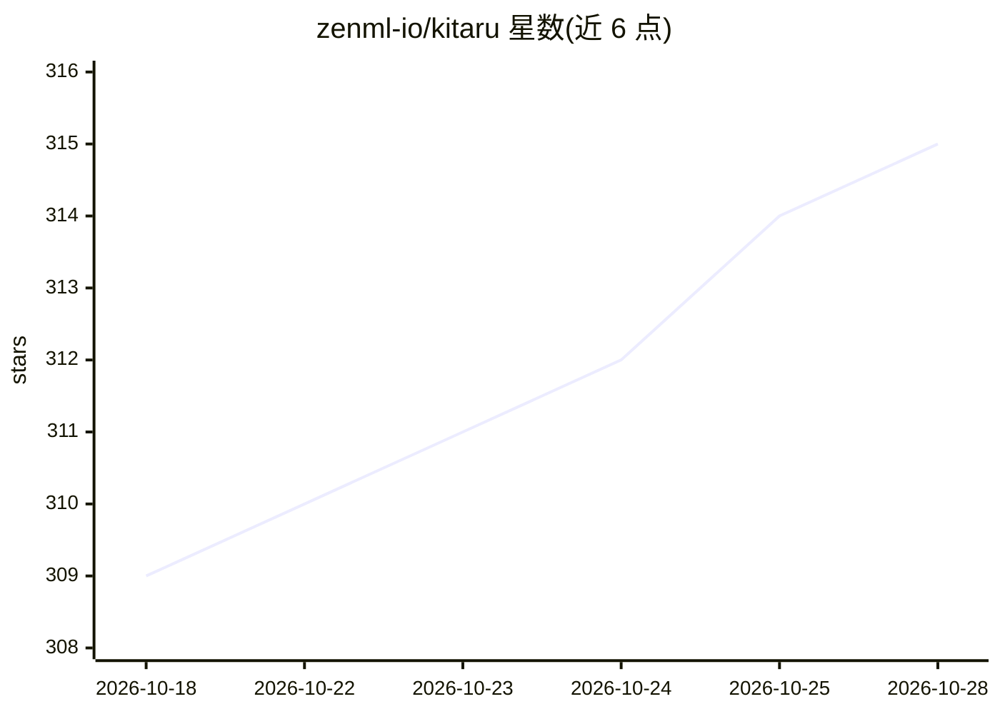

# zenml-io/kitaru

⭐ 315 · Python · Apache-2.0 · 推送 2026-10-27 · [GitHub](https://github.com/zenml-io/kitaru) · [官网](https://kitaru.ai) · 组织维护

**给 AI agent 开发者的回放式评测工具：录制生产运行并重放验证变更**

Kitaru 是面向 AI agent 团队的回放式评测系统：将 agent 运行录制或从 Langfuse、LangSmith、Braintrust、Logfire、Arize Phoenix、MLflow 导入为 session，通过重放（工具调用由录制应答）在更换模型/提示词/代码后对比改进与回归。评测引入人工判断校准评估器，cohort 冻结样本后在发布前实验。提供 Python/TypeScript SDK 与 6 个框架适配器（PydanticAI、LangGraph、OpenAI Agents SDK、Claude Agent SDK、Mastra、Vercel AI SDK），通过 MCP server 与技能接入 Claude Code、Codex、Cursor、Windsurf 等编码助手。自托管设计：服务器跑在自有基础设施（含 Docker 镜像与 Helm chart），回放运行在用户环境的 worker 上。由 ZenML 团队维护，Apache 2.0；本地服务器免费，托管云为 14 天试用。

## 筛选速览

| 维度 | 判定 | 备注 |
|---|---|---|
| AI 角色 | `ai-ecosystem` | LLM/agent 周边工具 |
| 许可风险 | `permissive` | Apache-2.0 |
| 部署形态 | `library` | 以包/库形式分发 |
| 模型依赖 | — | README 未给出锁定关系 |
| 硬件要求 | — | 无带数字的原话,不猜 |
| 安装摩擦 | `low` | 无编译、无系统依赖或容器化 |
| 成熟度 | — | 结构信号不足 |

## 能力要点

- 回放重执行 agent 代码，工具调用由录制应答，不产生真实副作用
- 从 6 种 trace 平台导入历史运行，trace 存储仍是系统记录源
- 人工判断校准评估器，cohort 冻结样本后做发布前实验
- MCP server + agent skills 接入 Claude Code/Codex/Cursor/Windsurf

## 适用场景

- 换了模型或提示词后，用生产回放验证 agent 是否回归再上线
- 把已积累的 Langfuse/LangSmith trace 变成可运行的回归测试套件
- 让编码助手驱动调研-访谈-实验-报告的评测循环

## 场景标签

`模型评测` · 领域:评测与运维

## 证据(README 行号)

> L7:  Kitaru (来る, "to arrive") gives you replay-based evals for AI agents. Record or import production runs as sessions, 
> L30: - **Replay re-executes your code.** Your real agent runs again, with tool calls answered from the recording, so no 
> L31: - **Evaluation starts with human judgment.** Your coding assistant reviews the sessions that matter, interviews you

## 星数曲线

2026-10-18 309 → 2026-10-28 315（+6）

---
*卡片 v1 · prompt 1.4 · 生成 2026-10-21 · 置信度 high · 依据 README sha `0a40f3adb5b1` · [字段定义](../../DATASET.md)*
