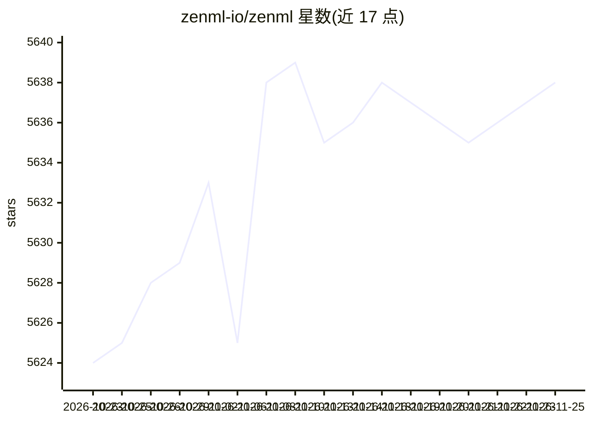

# zenml-io/zenml

⭐ 5,638 · Python · Apache-2.0 · 推送 2026-11-24 · [GitHub](https://github.com/zenml-io/zenml) · [官网](https://zenml.io) · 组织维护

**面向 ML/AI 工程师的 MLOps 编排平台：管道到 Agent**

ZenML 是供企业内 ML/AI 工程师使用的开源工作流编排平台：用 Python 编写 pipeline，在可配置的基础设施栈上运行，自动容器化与追踪代码，记录每次运行的指标、日志与元数据，并集成 MLflow、LangGraph、Langfuse、SageMaker、GCP Vertex 等既有工具。采用客户端-服务器架构，内置 Web 仪表盘，支持本地与 Kubernetes 等生产部署；另提供 MCP Server 以自然语言查询管道，以及 VS Code/Cursor 扩展。Apache 2.0 许可，另有 ZenML Pro 商业注册服务。

## 筛选速览

| 维度 | 判定 | 备注 |
|---|---|---|
| AI 角色 | `ai-ecosystem` | LLM/agent 周边工具 |
| 许可风险 | `permissive` | Apache-2.0 |
| 部署形态 | `library` | 以包/库形式分发 |
| 模型依赖 | — | README 未给出锁定关系 |
| 硬件要求 | — | 无带数字的原话,不猜 |
| 安装摩擦 | `low` | 无编译、无系统依赖或容器化 |
| 成熟度 | — | 结构信号不足 |

## 能力要点

- 以 pipeline/stack 抽象编排任意 Python 逻辑，自动容器化并追踪运行元数据
- 集成 MLflow、LangGraph、Langfuse、SageMaker、Kubernetes 等工具与编排器
- ZenML MCP Server 支持通过 Claude Desktop/Cursor 以自然语言查询与触发部署
- 提供 VS Code/Cursor 编辑器扩展管理管道

## 适用场景

- 把训练、评估到部署的 MLOps 流程统一编排到生产环境
- 在统一框架中同时管理传统 ML 模型与 LLM Agent 工作流
- 通过 Kubernetes 编排器在自有集群上运行 AI 流水线
- 用自然语言查询管道运行状态与指标并触发部署

## 场景标签

`MLOps` · 领域:训练与推理

## 证据(README 行号)

> L24: ZenML is built for ML or AI Engineers working on traditional ML use-cases, LLM workflows, or agents, in a company s
> L26: At it's core, ZenML allows you to write **workflows (pipelines)** that run on any **infrastructure backend (stacks)
> L31: 4. Integrating your existing tools and infrastructure e.g. MLflow, Langgraph, Langfuse, Sagemaker, GCP Vertex, etc.

## 星数曲线

2026-10-23 5,624 → 2026-11-25 5,638（+14）

---
*卡片 v1 · prompt 1.4 · 生成 2026-11-22 · 置信度 high · 依据 README sha `f6a5baeb66dc` · [字段定义](../../DATASET.md)*
