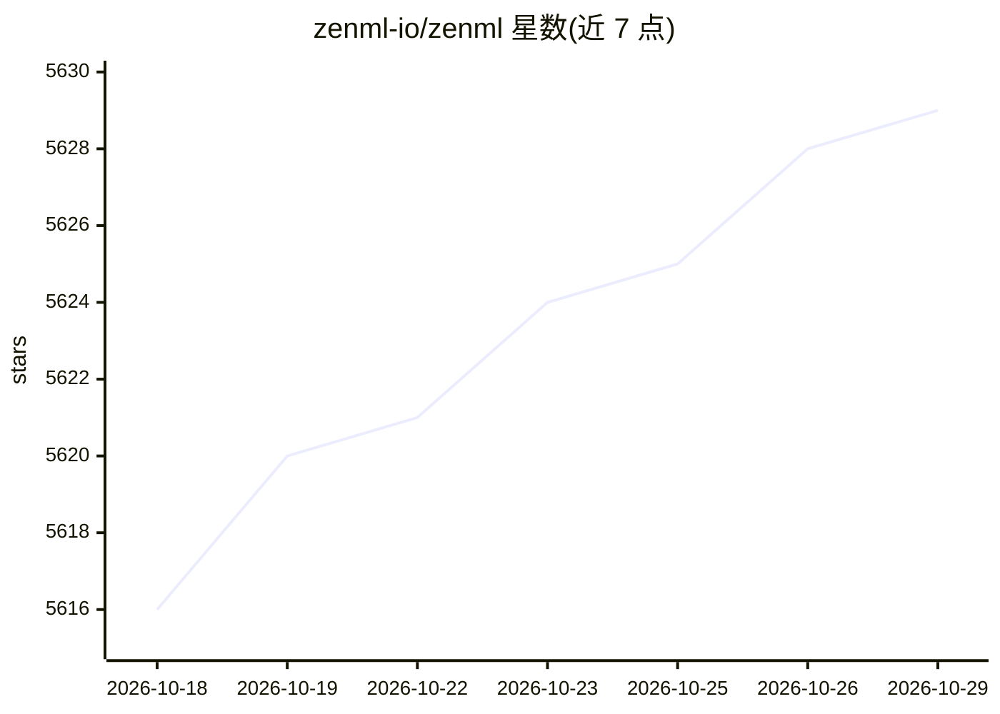

# zenml-io/zenml

⭐ 5,629 · Python · Apache-2.0 · 推送 2026-10-28 · [GitHub](https://github.com/zenml-io/zenml) · [官网](https://zenml.io) · 组织维护

**面向 ML/AI 工程师的 MLOps/LLMOps 流水线编排平台**

ZenML 是供企业内 ML/AI 工程师使用的开源平台：以 Python 代码定义工作流（pipelines），可嵌入模型训练或 agent 循环等任意逻辑，运行在可替换的基础设施后端（stacks）上。核心机制包括自动容器化并跟踪代码、记录每次运行的指标/日志/元数据、抽象基础设施复杂度、集成 MLflow/LangGraph/SageMaker/Vertex 等既有工具。采用客户端-服务器架构并带 Web 仪表盘，另提供 MCP Server 供 Claude Desktop/Cursor 以自然语言查询流水线。Apache 2.0 许可，另有 ZenML Pro 付费服务。

## 筛选速览

| 维度 | 判定 | 备注 |
|---|---|---|
| AI 角色 | `ai-ecosystem` | LLM/agent 周边工具 |
| 许可风险 | `permissive` | Apache-2.0 |
| 部署形态 | `library` | 以包/库形式分发 |
| 模型依赖 | — | README 未给出锁定关系 |
| 硬件要求 | — | 无带数字的原话,不猜 |
| 安装摩擦 | `low` | 无编译、无系统依赖或容器化 |
| 成熟度 | — | 结构信号不足 |

## 能力要点

- 以 pipelines + stacks 抽象运行任意 Python 逻辑于任意基础设施后端
- 自动容器化、运行跟踪（指标/日志/元数据）与可观测层
- 集成 MLflow、LangGraph、Langfuse、SageMaker、GCP Vertex 等工具
- ZenML MCP Server 支持在 Claude Desktop/Cursor 中用自然语言查询与触发流水线

## 适用场景

- 把模型训练、评估、部署流程组织为可复现的生产流水线
- 统一管理传统 ML 模型与 AI agent 的全生命周期
- 团队在开发和生产环境中迭代实验并追踪运行结果

## 场景标签

`MLOps` · 领域:训练与推理

## 证据(README 行号)

> L23: ZenML is built for ML or AI Engineers working on traditional ML use-cases, LLM workflows, or agents, in a company s
> L25: At it's core, ZenML allows you to write **workflows (pipelines)** that run on any **infrastructure backend (stacks)
> L30: 4. Integrating your existing tools and infrastructure e.g. MLflow, Langgraph, Langfuse, Sagemaker, GCP Vertex, etc.

## 星数曲线

2026-10-18 5,616 → 2026-10-29 5,629（+13）

---
*卡片 v1 · prompt 1.4 · 生成 2026-10-20 · 置信度 high · 依据 README sha `1c6af7d1477b` · [字段定义](../../DATASET.md)*
