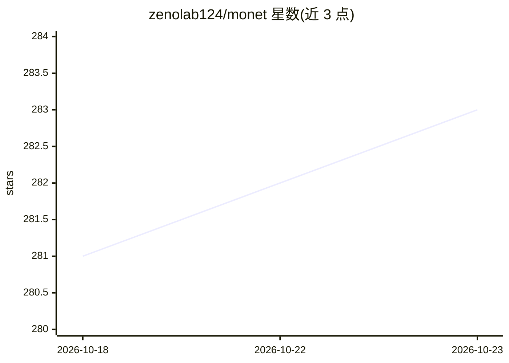

# zenolab124/monet

⭐ 283 · Rust · MIT · 推送 2026-10-07 · [GitHub](https://github.com/zenolab124/monet) · [官网](https://github.com/zenolab124/monet/releases) · 个人维护 · 中文 README

**管理 Claude Code/Codex 等编码代理会话的桌面指挥台**

基于 Tauri（Rust+Vue）的原生桌面应用，把 Claude Code 与 Codex 会话收进统一界面：档案馆零导入展示本机历史、毫秒级全文搜索、多列并行工作台（状态/token 监控、权限审批、失败重试）、赛马模式跨引擎对拼、自然语言定时任务、菜单栏订阅额度与桌面小组件。原始会话文件只读，增值数据独立存放于 ~/.monet/，本地能力离线运行、零遥测。AI 增值走用户自有渠道（BYOAI），内置 MCP server。macOS 全功能，Windows 覆盖核心功能，Linux 暂无计划。

## 筛选速览

| 维度 | 判定 | 备注 |
|---|---|---|
| AI 角色 | `ai-ecosystem` | LLM/agent 周边工具 |
| 许可风险 | `permissive` | MIT |
| 部署形态 | `desktop` | 安装包/桌面程序 |
| 模型依赖 | — | README 未给出锁定关系 |
| 硬件要求 | — | 无带数字的原话,不猜 |
| 安装摩擦 | `low` | 无编译、无系统依赖或容器化 |
| 成熟度 | — | 结构信号不足 |

## 能力要点

- Claude Code 与 Codex 会话统一浏览、搜索与并行指挥
- 赛马模式：同一问题广播给不同引擎/模型/渠道并排对比
- 权限请求 GUI 卡片化，危险命令红色警示
- 内置 MCP server，会话内 Agent 可搜历史、建定时任务

## 适用场景

- 我同时跑多个编码代理任务，想在一面墙上看状态和审批权限
- 回看和搜索散落各项目的 Claude Code/Codex 历史会话
- 同一道题让不同引擎对拼，比较答案与成本

## 场景标签

 · 领域:开发者工具/编码代理管理

## 证据(README 行号)

> L35: Monet 把 Claude Code、Codex 等引擎收进一面墙：所有 Agent 会话可浏览、可搜索、可并行指挥。Agent 干活，Monet 给你眼睛和手。
> L51: - Claude Code 与 Codex 的项目、会话和时间线统一进入档案馆、搜索、工作台与通知，并可按引擎筛选
> L107: - 内置 MCP server：会话里的 Claude 能直接搜你的历史、建定时任务、查看 Runner 日志

## 星数曲线

2026-10-18 281 → 2026-10-23 283（+2）

---
*卡片 v1 · prompt 1.4 · 生成 2026-10-22 · 置信度 mid · 依据 README sha `ec43e7b05967` · [字段定义](../../DATASET.md)*
