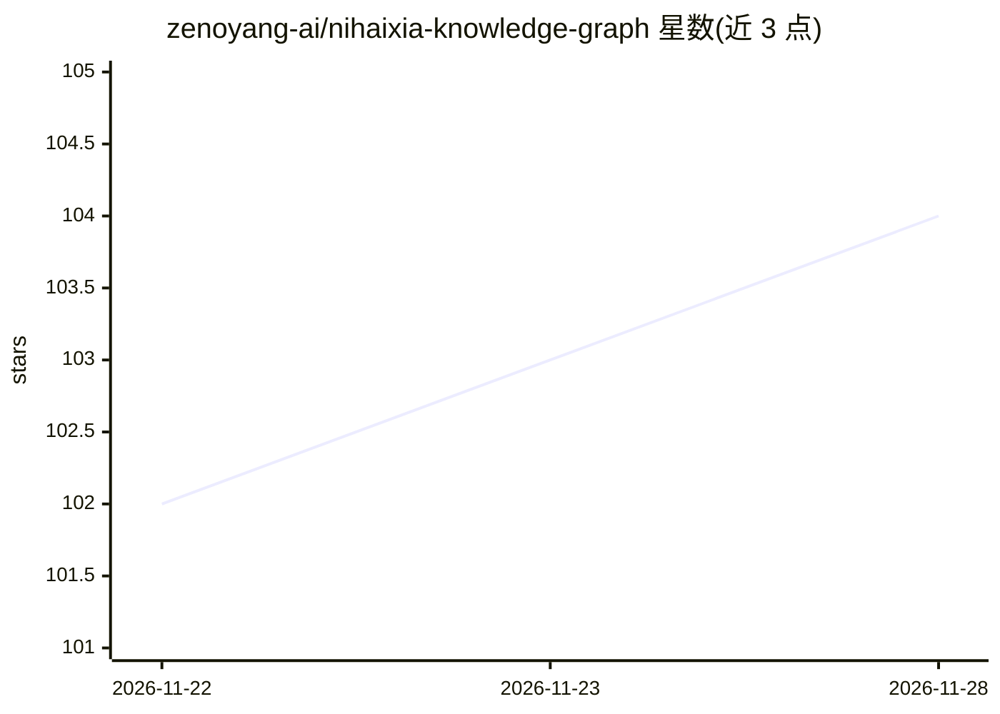

# zenoyang-ai/nihaixia-knowledge-graph

⭐ 104 · JavaScript · NOASSERTION · 推送 2026-11-24 · [GitHub](https://github.com/zenoyang-ai/nihaixia-knowledge-graph) · [官网](https://www.nihaixia-knowledge.xyz) · 个人维护 · 中文 README

**倪海厦中医与易经资料库：图谱网站+笔记+AI语料**

将倪海厦公开讲授的中医（人纪）与易经术数（天纪）整理为公开资料库：免费在线网站提供五层级 69 个核心节点的交互式图谱、学习路径与基于资料库的 AI 问答；仓库开源全部节点笔记、AI 语料包（合并 md/jsonl 格式）、分章校勘文本，以及可安装到 Claude Code 等编程工具的天纪 Agent Skill。支持 Obsidian 双链笔记导入、Releases 打包下载离线使用。明确禁止照方抓药等医疗用途，内容限个人非商业学习。

## 筛选速览

| 维度 | 判定 | 备注 |
|---|---|---|
| AI 角色 | `ai-knowledge` | 知识聚合/清单类 |
| 许可风险 | `none` | NOASSERTION |
| 部署形态 | `library` | 以包/库形式分发 |
| 模型依赖 | — | README 未给出锁定关系 |
| 硬件要求 | — | 无带数字的原话,不猜 |
| 安装摩擦 | `low` | 无编译、无系统依赖或容器化 |
| 成熟度 | — | 结构信号不足 |

## 能力要点

- 五层级 69 核心节点的交互式知识图谱与学习路径
- AI 语料包含合并 md、jsonl 结构化文件与 MANIFEST.json
- 64 张概念卡+5 篇专题的 Obsidian 双链笔记包
- npx 一行命令安装天纪 Agent Skill（八字/紫微/易经/小六壬）

## 适用场景

- 系统梳理倪海厦人纪与天纪的学习脉络
- 把语料包导入 NotebookLM/Dify 等工具做中文问答
- 在 Obsidian 中维护个人中医学习双链笔记库
- 在 AI 编程工具中调用天纪提示词做八字排盘

## 场景标签

`知识库管理` `知识图谱` `RAG` `文档问答` · 领域:知识与检索

## 证据(README 行号)

> L25: 1. **搭了一个免费在线网站**：把人纪和天纪拆成五个层级、69 个核心节点，配好学习顺序、关系图谱和基于资料库的 AI 问答。
> L38: |喂给 NotebookLM / Claude / Dify|`knowledge/02-AI知识库语料包/`|合并单文件 `nihaixia-corpus-all.md`、结构化 `jsonl`、提示词合集与 `MANIFEST
> L41: |在 AI 编程工具里用天纪提示词|`skills/nihaixia-tianji/`|可直接安装的 Agent Skill，覆盖八字、紫微斗数、易经三才和小六壬|

## 星数曲线

2026-11-22 102 → 2026-11-28 104（+2）

---
*卡片 v1 · prompt 1.4 · 生成 2026-11-22 · 置信度 high · 依据 README sha `cf2e771c2800` · [字段定义](../../DATASET.md)*
