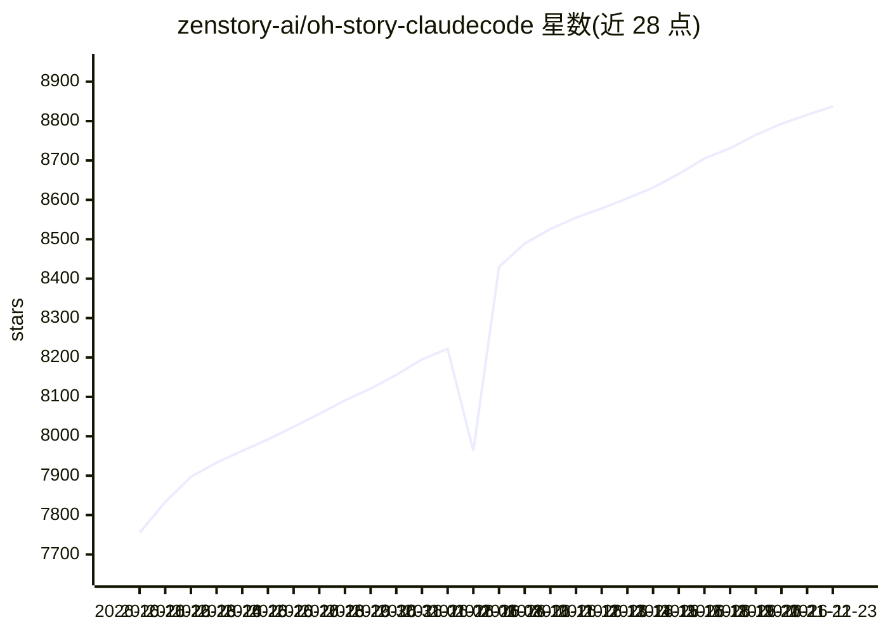

# zenstory-ai/oh-story-claudecode

⭐ 8,837 · JavaScript · MIT · 推送 2026-11-22 · [GitHub](https://github.com/zenstory-ai/oh-story-claudecode) · [官网](https://zenstory.ai/zh/oh-story) · 组织维护 · 中文 README

**给网文作者的编程 Agent 技能包：扫榜拆文到连载成稿**

以 14 个 skill 形式装进编程 Agent 的网文写作流程包，覆盖扫榜选材、拆解爆款、大纲细纲、长短篇正文写作、伏笔追踪、去 AI 味改稿与封面提示词生成。用文件系统保存设定、大纲、正文与追踪状态，维护「作者真相 / 读者已知」双时间线；写前拦截缺细纲或状态异常，写后自动检查断章与常见 AI 句式。复用宿主 Agent 的模型，不单独配模型，另提供仅监听 127.0.0.1 的本地网页工作台。

## 筛选速览

| 维度 | 判定 | 备注 |
|---|---|---|
| AI 角色 | `ai-native` | 本体是模型或模型工具 |
| 许可风险 | `permissive` | MIT |
| 部署形态 | `library` | 以包/库形式分发 |
| 模型依赖 | — | README 未给出锁定关系 |
| 硬件要求 | — | 无带数字的原话,不猜 |
| 安装摩擦 | `low` | 无编译、无系统依赖或容器化 |
| 成熟度 | — | 结构信号不足 |

## 能力要点

- 14 个 skill 覆盖扫榜、拆文、写作、去AI味、封面全流程，适配 7 款编程 Agent
- 文件系统作记忆，`_tracking-state.json` 统一回写，换会话后可续写
- 「作者真相 / 读者已知」双时间线与伏笔、角色状态追踪
- 本地脚本扫描高频 AI 句式，区分硬阻断与需复核项

## 适用场景

- 在 Claude Code / Codex 里连载长篇网文并追踪伏笔
- 拆解爆款小说抽出情节节点与写作手法复用
- 导入已发布旧稿整理成标准目录后继续写
- 扫描并改写正文中的 AI 味句式

## 场景标签

 · 领域:内容创作/写作工具

## 证据(README 行号)

> L3:  网文写作 skill 包：扫榜、拆文、写作、去AI味、封面图一套流程，装进你正在用的编程 Agent。
> L27: Oh Story 覆盖长篇与短篇网文全流程：**扫榜选材 → 拆解爆款 → 搭大纲写正文 → 去AI味 → 生成封面图**。它以 14 个 skill 的形式装进你正在用的编程 Agent，直接复用该工具的模型，无需显卡，也不用单
> L31: - **适配 7 款编程 Agent** — Claude Code · Codex CLI · Google Antigravity · OpenCode · ZCode · OpenClaw · Reasonix；支持子代理与

## 星数曲线

2026-10-21 7,755 → 2026-11-23 8,837（+1,082）

---
*卡片 v1 · prompt 1.4 · 生成 2026-11-23 · 置信度 high · 依据 README sha `d3317e0f545b` · [字段定义](../../DATASET.md)*
