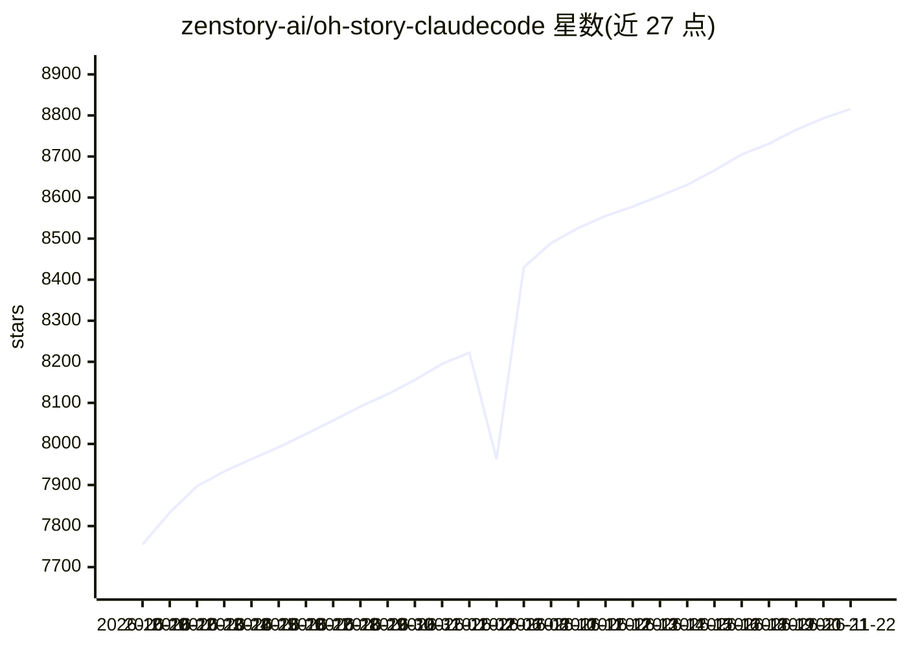

# zenstory-ai/oh-story-claudecode

⭐ 8,816 · Python · MIT · 推送 2026-11-20 · [GitHub](https://github.com/zenstory-ai/oh-story-claudecode) · [官网](https://zenstory.ai/zh/oh-story) · 组织维护 · 中文 README

**装进编程 Agent 的网文写作技能包：扫榜、拆文、连载、去AI味**

Oh Story 以 14 个 skill 的形式部署进 Claude Code、Codex CLI 等 7 款编程 Agent，直接复用其所装工具的模型，无需单独配置模型或显卡。流程覆盖扫榜选材、拆解爆款、搭大纲写正文、去 AI 味、生成封面图；用文件系统作记忆，设定、大纲、正文与追踪数据分目录保存，「作者真相 / 读者已知」双时间线防止伏笔泄漏。面向起点、番茄、晋江、七猫等长短篇平台；本地工作台仅监听 127.0.0.1。

## 筛选速览

| 维度 | 判定 | 备注 |
|---|---|---|
| AI 角色 | `ai-native` | 本体是模型或模型工具 |
| 许可风险 | `permissive` | MIT |
| 部署形态 | `library` | 以包/库形式分发 |
| 模型依赖 | — | README 未给出锁定关系 |
| 硬件要求 | — | 无带数字的原话,不猜 |
| 安装摩擦 | `low` | 无编译、无系统依赖或容器化 |
| 成熟度 | — | 结构信号不足 |

## 能力要点

- 14 个 skill 装进编程 Agent，复用其模型，无需显卡
- 文件系统作记忆：状态卡、伏笔清单与双时间线自动回写 _tracking-state.json
- 7 个专职角色与读写守卫，缺细纲或追踪未入账时先拦截
- 本地脚本扫描高频 AI 句式并按语境改稿，支持 GPT-Image-2 生成封面

## 适用场景

- 开新书前先扫榜看题材风口、拆爆款学黄金三章写法
- 连载几百章时用追踪文件保持人设与伏笔一致
- 把已有旧稿导入整理成标准目录后接着写
- 对 AI 味重的正文做句式扫描与改稿

## 场景标签

`AI 写作` `图像生成` · 领域:内容生成

## 证据(README 行号)

> L27: Oh Story 覆盖长篇与短篇网文全流程：**扫榜选材 → 拆解爆款 → 搭大纲写正文 → 去AI味 → 生成封面图**。它以 14 个 skill 的形式装进你正在用的编程 Agent，直接复用该工具的模型，无需显卡，也不用单
> L31: - **适配 7 款编程 Agent** — Claude Code · Codex CLI · Google Antigravity · OpenCode · ZCode · OpenClaw · Reasonix；支持子代理与

## 星数曲线

2026-10-20 7,755 → 2026-11-22 8,816（+1,061）

---
*卡片 v1 · prompt 1.4 · 生成 2026-11-22 · 置信度 high · 依据 README sha `9022d5a7411c` · [字段定义](../../DATASET.md)*
