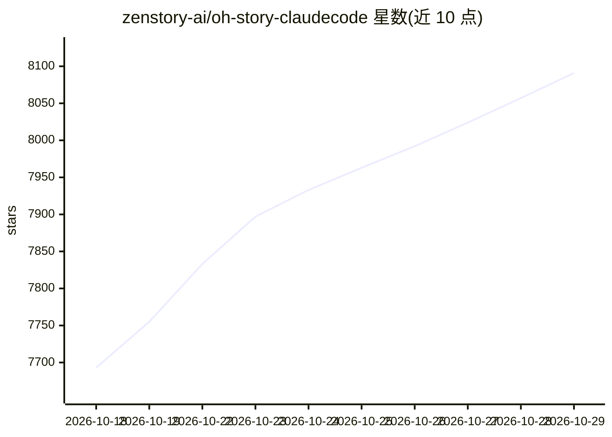

# zenstory-ai/oh-story-claudecode

⭐ 8,091 · Python · MIT · 推送 2026-10-26 · [GitHub](https://github.com/zenstory-ai/oh-story-claudecode) · [官网](https://zenstory.ai/oh-story) · 组织维护 · 中文 README

**装进编程 Agent 的中文网文写作 skill 包（13 个技能）**

面向起点、番茄、晋江、知乎盐言等中文网文平台的写作 skill 包，以 13 个 skill 安装进 Claude Code、Codex CLI、Antigravity、OpenCode 等 7 款编程 Agent，覆盖扫榜、拆文、大纲与正文写作、去 AI 味、封面生成全流程。写作用模型即宿主 Agent 的模型，无需 GPU 或另配模型，本地只跑确定性检查脚本（Node/Python）。以文件系统作为记忆维护设定、大纲、正文与追踪，支持写前门禁与写后校验，可导入已有书稿续写。

## 筛选速览

| 维度 | 判定 | 备注 |
|---|---|---|
| AI 角色 | `ai-ecosystem` | LLM/agent 周边工具 |
| 许可风险 | `permissive` | MIT |
| 部署形态 | `library` | 以包/库形式分发 |
| 模型依赖 | — | README 未给出锁定关系 |
| 硬件要求 | `cpu-ok` | |
| 安装摩擦 | `low` | 无编译、无系统依赖或容器化 |
| 成熟度 | — | 结构信号不足 |

## 能力要点

- 13 个 skill 覆盖扫榜/拆文/写作/去AI味/封面全流程，支持长篇与短篇
- 文件系统当记忆：设定、大纲、正文、追踪独立维护，含「作者真相/读者已知」双时间线
- 本地确定性检查脚本做写作 lint 与章级门禁
- 适配 7 款编程 Agent，`npx skills add` 一条命令安装

## 适用场景

- 在 Claude Code / Codex 等编程 Agent 里续写或新开网文长篇
- 把已写的小说反向导入成可续写工程
- 拆解爆款对标书提取可复用情节节点与写作手法
- 扫描并改写正文中的已知 AI 句式

## 场景标签

`AI 写作` · 领域:内容生成

## 证据(README 行号)

> L25: Oh Story 覆盖长篇与短篇网络小说的全流程：**扫榜选材 → 拆解爆款 → 搭大纲写正文 → 去AI味 → 生成封面图**。
> L30: - **适配 7 款编程 Agent** — Claude Code · Codex CLI · Google Antigravity · OpenCode · ZCode · OpenClaw · Reasonix；能读取项目文
> L262: 不需要。oh-story-claudecode 是一组 skill，运行在你已经在用的编程 Agent 里，写作用的模型就是该 Agent 的模型；本地只跑确定性的检查脚本（Node / Python）。唯一的例外是 `stor

## 星数曲线

2026-10-18 7,693 → 2026-10-29 8,091（+398）

---
*卡片 v1 · prompt 1.4 · 生成 2026-10-20 · 置信度 high · 依据 README sha `2a3811373605` · [字段定义](../../DATASET.md)*
