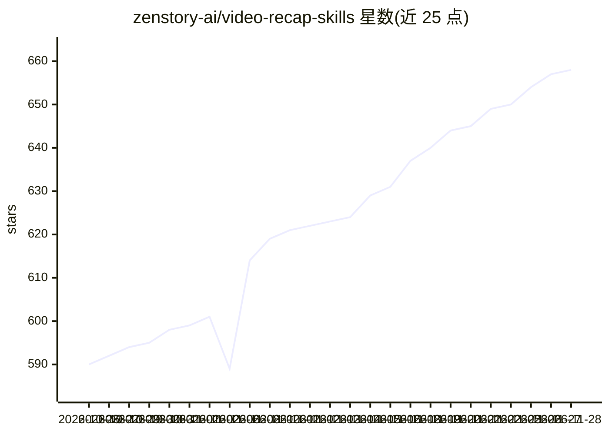

# zenstory-ai/video-recap-skills

⭐ 658 · Python · MIT · 推送 2026-11-27 · [GitHub](https://github.com/zenstory-ai/video-recap-skills) · [官网](https://zenstory.ai/zh/video-recap) · 组织维护 · 中文 README

**给编程 Agent 用的视频解说剪辑技能包：切镜、配音、成片**

包含 video-recap 与 video-reference 两个自包含技能，供 Claude Code、Codex CLI、OpenCode、OpenClaw、Google Antigravity 等编程 Agent 调用，完成抽帧拉片、叙事剪辑方案、TTS 配音、混音、字幕包装、物理质检与剪映/CapCut 草稿导出。核心链路仅依赖 Python 3.10+ 标准库与 ffmpeg，默认本地运行、零第三方 Python 依赖、无需必填 API Key；剪辑经验沉淀为规范文档，交付物围绕 timeline.json 组织。云端转写与配音需显式配置环境变量。

## 筛选速览

| 维度 | 判定 | 备注 |
|---|---|---|
| AI 角色 | `ai-native` | 本体是模型或模型工具 |
| 许可风险 | `permissive` | MIT |
| 部署形态 | `library` | 以包/库形式分发 |
| 模型依赖 | locked-api |  |
| 硬件要求 | — | 无带数字的原话,不猜 |
| 安装摩擦 | `medium` | 含编译或系统依赖之一 |
| 成熟度 | — | 结构信号不足 |

## 能力要点

- 两个技能（video-recap/video-reference）+ 6 支核心原子 CLI，交付 timeline.json 与成片
- 默认纯本地运行：零第三方 Python 依赖、无需必填 API Key
- 支持导出剪映/CapCut 多轨草稿与本地审片台逐句核对
- 物理质检区分硬性错误与人工复核提示

## 适用场景

- 让编程 Agent 自动把剧集剪成带旁白解说的短视频
- 导出剪映草稿后继续人工精修
- 拆解参考成片的镜头节奏与响度，整理可复用剪辑笔记

## 场景标签

`语音合成` `语音识别` `图像视频处理` · 领域:内容生成

## 证据(README 行号)

> L5:  面向编程 Agent 的视频剪辑与解说技能包：覆盖拉片看图、叙事剪辑、配音混音、字幕包装、成片质检与剪映草稿导出，支持 Claude Code、Google Antigravity (AGY)、Codex CLI、OpenCode
> L61: - **零第三方 Python 依赖、默认本地运行**：核心链路只需 Python 3.10+ 标准库与 `ffmpeg` / `ffprobe`，无需 `pip install`，也无需必填 API Key；仅在显式配置云端转写

## 星数曲线

2026-10-26 590 → 2026-11-28 658（+68）

---
*卡片 v1 · prompt 1.4 · 生成 2026-11-28 · 置信度 mid · 依据 README sha `3941cd420f31` · [字段定义](../../DATASET.md)*
