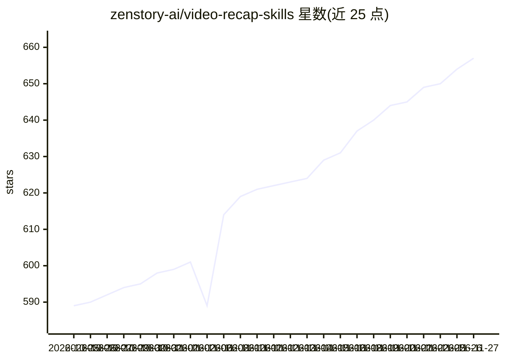

# zenstory-ai/video-recap-skills

⭐ 657 · Python · MIT · 推送 2026-11-26 · [GitHub](https://github.com/zenstory-ai/video-recap-skills) · [官网](https://zenstory.ai/zh/video-recap) · 组织维护 · 中文 README

**给编程 Agent 的视频解说剪辑技能包，可导出剪映草稿**

包含 video-recap 与 video-reference 两个自包含技能的插件包，供 Claude Code、Google Antigravity、Codex CLI、OpenCode、OpenClaw 等编程 Agent 安装调用。多模态 Agent 负责抽帧拉片、写分镜与解说方案，本地脚本负责裁切、配音测时、混音、包装、质检与剪映/CapCut 多轨草稿导出。核心链路仅需 Python 3.10+ 标准库与 ffmpeg，无必填 API Key，仅在配置云端转写或云端配音时发起外部请求。

## 筛选速览

| 维度 | 判定 | 备注 |
|---|---|---|
| AI 角色 | `ai-ecosystem` | LLM/agent 周边工具 |
| 许可风险 | `permissive` | MIT |
| 部署形态 | `library` | 以包/库形式分发 |
| 模型依赖 | — | README 未给出锁定关系 |
| 硬件要求 | — | 无带数字的原话,不猜 |
| 安装摩擦 | `medium` | 含编译或系统依赖之一 |
| 成熟度 | — | 结构信号不足 |

## 能力要点

- 抽帧拼图拉片后写分镜方案，剪辑与解说经验沉淀为技能规范
- 核心链路零第三方 Python 依赖，默认本地运行、无必填 API Key
- 导出剪映/CapCut 多轨草稿（原片/解说/BGM/音效/字幕分轨）
- 支持 Fish Audio 整篇连续配音与 spoken_text 多音字标注

## 适用场景

- 把剧集素材自动剪成带旁白解说的剧情 recap 视频
- 导出剪映草稿后人工继续精修成片
- 拆解参考成片的镜头节奏与响度，沉淀可复用剪辑笔记

## 场景标签

`图像视频处理` · 领域:感知与多模态

## 证据(README 行号)

> L5:  面向编程 Agent 的视频剪辑与解说技能包：覆盖拉片看图、叙事剪辑、配音混音、字幕包装、成片质检与剪映草稿导出，支持 Claude Code、Google Antigravity (AGY)、Codex CLI、OpenCode
> L61: - **零第三方 Python 依赖、默认本地运行**：核心链路只需 Python 3.10+ 标准库与 `ffmpeg` / `ffprobe`，无需 `pip install`，也无需必填 API Key；仅在显式配置云端转写

## 星数曲线

2026-10-25 589 → 2026-11-27 657（+68）

---
*卡片 v1 · prompt 1.4 · 生成 2026-11-26 · 置信度 low · 依据 README sha `6502549a6da3` · [字段定义](../../DATASET.md)*
