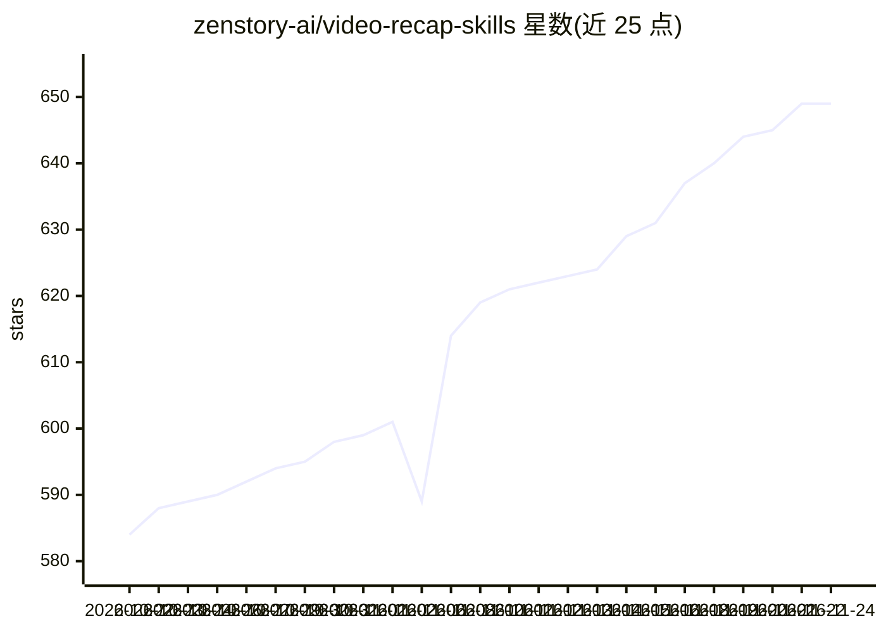

# zenstory-ai/video-recap-skills

⭐ 649 · Python · MIT · 推送 2026-11-22 · [GitHub](https://github.com/zenstory-ai/video-recap-skills) · [官网](https://zenstory.ai/zh/video-recap) · 组织维护 · 中文 README

**给编程 Agent 的视频剪辑解说技能包，产出成片与剪映草稿**

面向编程 Agent（Claude Code、Codex CLI、OpenCode、OpenClaw）的技能包，包含 video-recap 与 video-reference 两个技能：由多模态 Agent 看抽帧拼图写分镜与解说方案，本地 Python 脚本负责裁切、配音测时、混音、字幕包装与物理质检，最终产出 out/final.mp4、timeline.json 与剪映/CapCut 多轨草稿。核心链路零第三方 Python 依赖，仅用 Python 3.10+ 标准库与 ffmpeg/ffprobe，默认本地运行，仅在显式配置云端 ASR/配音时发起外部请求。

## 筛选速览

| 维度 | 判定 | 备注 |
|---|---|---|
| AI 角色 | `ai-native` | 本体是模型或模型工具 |
| 许可风险 | `permissive` | MIT |
| 部署形态 | `library` | 以包/库形式分发 |
| 模型依赖 | — | README 未给出锁定关系 |
| 硬件要求 | — | 无带数字的原话,不猜 |
| 安装摩擦 | `medium` | 含编译或系统依赖之一 |
| 成熟度 | — | 结构信号不足 |

## 能力要点

- 两个自包含技能：通用视频剪辑解说 video-recap 与参考成片拆解 video-reference
- 核心链路零第三方 Python 依赖，只需 Python 3.10+ 与 ffmpeg/ffprobe，默认本地运行
- 可导出剪映/CapCut 多轨草稿，原片、解说、BGM、音效、字幕分轨可编辑
- 物理质检区分硬性错误与复核提示，附浏览器本地审片台

## 适用场景

- 把剧集视频自动做成带旁白解说的剧情解说短视频
- 导出剪映草稿后在剪辑软件中继续人工精修
- 拆解参考成片的镜头节奏与响度，整理可复用的剪辑参考笔记

## 场景标签

`视频生成` · 领域:内容生成

## 证据(README 行号)

> L5:  面向编程 Agent 的视频剪辑与解说技能包：覆盖拉片看图、叙事剪辑、配音混音、字幕包装、成片质检与剪映草稿导出，支持 Claude Code、Codex CLI、OpenCode 与 OpenClaw。
> L61: - **零第三方 Python 依赖、默认本地运行**：核心链路只需 Python 3.10+ 标准库与 `ffmpeg` / `ffprobe`，无需 `pip install`，也无需必填 API Key；仅在显式配置云端转写

## 星数曲线

2026-10-22 584 → 2026-11-24 649（+65）

---
*卡片 v1 · prompt 1.4 · 生成 2026-11-24 · 置信度 mid · 依据 README sha `4655d351d61a` · [字段定义](../../DATASET.md)*
