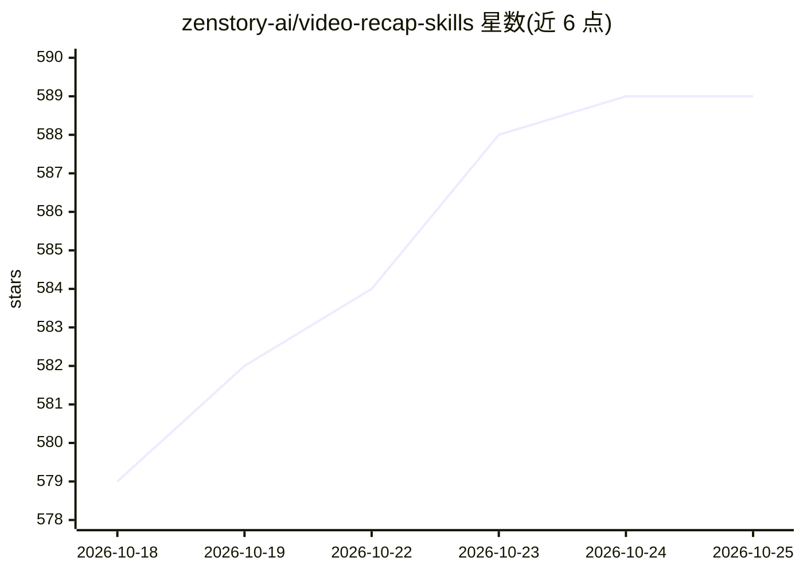

# zenstory-ai/video-recap-skills

⭐ 589 · Python · MIT · 推送 2026-10-21 · [GitHub](https://github.com/zenstory-ai/video-recap-skills) · [官网](https://zenstory.ai/video-recap) · 组织维护 · 中文 README

**给编程 Agent 的视频中文解说成片技能包（7 个技能）**

一套装入 Claude Code、Codex CLI、OpenCode 或 OpenClaw 的七个技能：Agent 接收视频路径与自然语言要求后，完成场景检测、ASR、VLM 分析、故事规划、剪辑、写稿、TTS 配音、混音与字幕合成，输出中文解说成片，并可一键导出可编辑的剪映/CapCut 多轨草稿。ASR、VLM、TTS 均走小米 MiMo API（可换 Fish Audio 配音），本地只需 Python 标准库与 ffmpeg，无需 GPU 与 pip install。每步产物（故事计划、时间线、QC 报告、修改记录）均为机器可读文件，附完整示例案例。

## 筛选速览

| 维度 | 判定 | 备注 |
|---|---|---|
| AI 角色 | `ai-native` | 本体是模型或模型工具 |
| 许可风险 | `permissive` | MIT |
| 部署形态 | `library` | 以包/库形式分发 |
| 模型依赖 | — | README 未给出锁定关系 |
| 硬件要求 | `cpu-ok` | |
| 安装摩擦 | `medium` | 含编译或系统依赖之一 |
| 成熟度 | — | 结构信号不足 |

## 能力要点

- 7 个技能衔接完整流程：理解→规划→剪辑→写稿→配音→组装
- ASR/VLM/TTS 统一走 MiMo，本地仅需 ffmpeg，无需 GPU
- timeline.json 可一键导出剪映/CapCut 可编辑多轨草稿
- 旁白 lint、组装 QC、最终 QC 生成机器可读报告

## 适用场景

- 把单集或多集视频做成中文解说成片
- 在剪映里继续编辑导出的多轨草稿
- 英语视频译成中文配音并保留原说话人声音（实验功能，需授权确认）
- 复用素材库与系列模板批量出同风格解说

## 场景标签

`图像视频处理` `语音识别` `语音合成` · 领域:内容生成

## 证据(README 行号)

> L31: 七个技能（六个生产 + 一个按需参考）装进 Claude Code、Codex CLI、OpenCode 或 OpenClaw，你用自然语言给出视频路径和想要的成片，Agent 负责理解画面与对白、
> L34: - **一个 key，本地只要 ffmpeg。** ASR、VLM、TTS 都走小米 MiMo，本地只用 Python 标准库和 `ffmpeg`，不需要 GPU，不需要 `pip install`，也不下载模型。配音可以换成 F

## 星数曲线

2026-10-18 579 → 2026-10-25 589（+10）

---
*卡片 v1 · prompt 1.4 · 生成 2026-10-21 · 置信度 mid · 依据 README sha `49774fa60939` · [字段定义](../../DATASET.md)*
