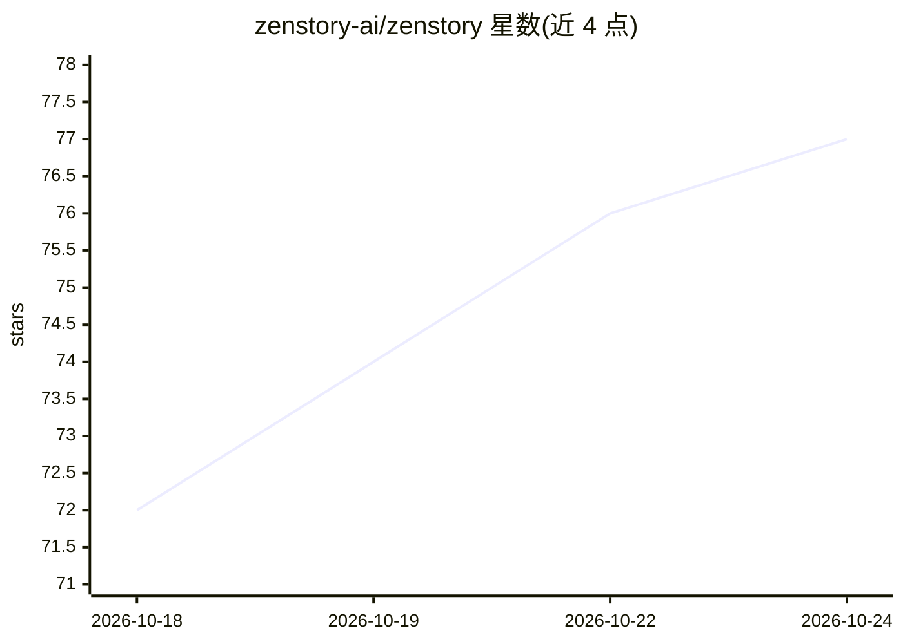

# zenstory-ai/zenstory

⭐ 77 · Python · MIT · 推送 2026-10-24 · [GitHub](https://github.com/zenstory-ai/zenstory) · [官网](https://zenstory.ai/workbench) · 组织维护 · 中文 README

**AI Agent 驱动的浏览器小说写作工作台**

在浏览器里写小说的三栏工作台（文件树、编辑器、AI 对话）：用户在对话中让 AI 直接新建、改写大纲、正文和角色卡文件，改动直接落盘并记录版本与项目快照。内置路由加四个专职 Agent（大纲规划师、爽点设计师、内容创作者、质量审稿人）与 14 个技能。每轮在约 32000 token 预算内附带项目资料；支持外部 Agent（Claude Code、Codex、OpenClaw）经 API Key 与 CLI 读写项目。可在 app.zenstory.ai 在线使用（免费版每天 3 条 AI 消息），或以 MIT 许可 Docker 自部署，默认接入 DeepSeek API，可切换 MiniMax 备用。

## 筛选速览

| 维度 | 判定 | 备注 |
|---|---|---|
| AI 角色 | `ai-native` | 本体是模型或模型工具 |
| 许可风险 | `permissive` | MIT |
| 部署形态 | `self-host` | docker 或自建部署 |
| 模型依赖 | locked-api |  |
| 硬件要求 | — | 无带数字的原话,不猜 |
| 安装摩擦 | `low` | 无编译、无系统依赖或容器化 |
| 成熟度 | — | 结构信号不足 |

## 能力要点

- 对话中 AI 直接新建/改写文件，带版本历史与项目快照可回滚
- 路由 + 四个专职 Agent（规划/爽点设计/写作/审稿）分工流程
- 14 个内置技能与 SKILL.md 格式自定义技能导入导出
- 外部 Agent（Claude Code/Codex/OpenClaw）可通过 API Key 和 zenstory CLI 读写项目

## 适用场景

- 写长篇小说/短篇/短剧剧本时用对话让 AI 起大纲、写正文、改稿
- 管理角色卡、设定与素材文件并保留可回滚的版本历史
- 让本地终端里的 Claude Code 等 Agent 直接续写工作台里的稿件
- 上传参考小说拆出摘要与角色档案供创作参考

## 场景标签

`多智能体` `AI 写作` · 领域:Agent 开发

## 证据(README 行号)

> L3:  对话即创作：在浏览器里写小说，AI 直接新建、改写你的大纲、正文和角色卡。
> L29: ZenStory 工作台是一个在浏览器里写小说的地方。大纲、正文、角色卡、设定、素材都是项目里的文件，你在右边和 AI 说话，AI 直接新建、改写这些文件，不用来回复制粘贴。可以在 app.zenstory.ai 在线用，也可以按
> L32: - **一个路由，四个专职 Agent**：路由结合本轮请求和必要的上一轮上下文选择流程，由大纲规划师、爽点设计师、内容创作者、质量审稿人接力。只要规划就停在规划；明确要求正文时才安排写作。高质量模式默认在成功写入的正文累计达到 

## 星数曲线

2026-10-18 72 → 2026-10-24 77（+5）

---
*卡片 v1 · prompt 1.4 · 生成 2026-10-24 · 置信度 mid · 依据 README sha `0361579ffb46` · [字段定义](../../DATASET.md)*
