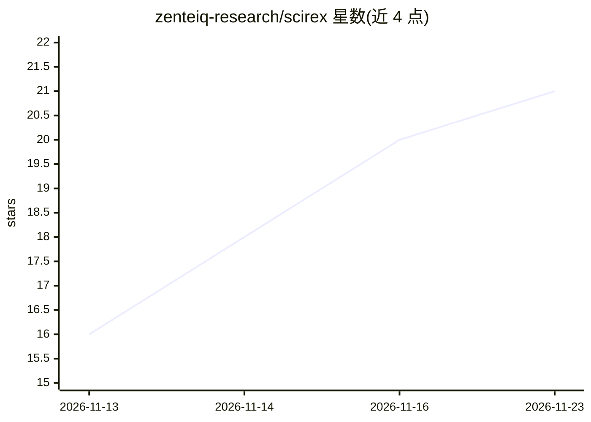

# zenteiq-research/scirex

⭐ 21 · Python · LGPL-3.0 · 推送 2026-11-20 · [GitHub](https://github.com/zenteiq-research/scirex) · [官网](https://zenteiq-research.github.io/scirex/) · 组织维护

**JAX/Flax 神经算子库：PDE 求解与物理系统代理建模**

JAX 原生的科学机器学习库，提供 FNO、WNO、GINO、Transolver 及实验性 GIWO 五种神经算子架构，统一模型接口，均兼容 jit/vmap/grad。神经算子学习函数空间之间的映射，在一种网格上训练后可在另一种网格上评估，用于 PDE 求解、代理建模与多尺度物理系统。内置九个基准问题（Darcy 流、Navier-Stokes、AirfRANS 等）与已发布权重对照，支持物理信息损失的无标签训练；LGPL-3.0 许可，由 ZenteiQ 公司维护。

## 筛选速览

| 维度 | 判定 | 备注 |
|---|---|---|
| AI 角色 | `ai-native` | 本体是模型或模型工具 |
| 许可风险 | `viral` | LGPL-3.0 |
| 部署形态 | `library` | 以包/库形式分发 |
| 模型依赖 | — | README 未给出锁定关系 |
| 硬件要求 | — | 无带数字的原话,不猜 |
| 安装摩擦 | `medium` | 含编译或系统依赖之一 |
| 成熟度 | — | 结构信号不足 |

## 能力要点

- 五种神经算子架构（FNO/WNO/GINO/Transolver/GIWO）统一模型接口，兼容 jit/vmap/grad
- 九个基准问题在匹配参数量下与论文结果对照，提供 reproduce 脚本复现
- 物理信息损失支持无标签解训练（如 Darcy 流仅用有限元能量）
- 训练权重托管于 Hugging Face，按模型与基准分仓

## 适用场景

- 用神经算子做 CFD/PDE 代理模型，跨网格评估无需重训
- 复现或对比 FNO/GINO/Transolver 等方法的基准结果
- 无标签数据下用物理信息损失训练 PDE 求解器

## 场景标签

`科研工具` `模型训练` · 领域:学习与行业

## 证据(README 行号)

> L17: ScireX is a JAX-native library of neural operators for
> L24: It provides four architectures behind one model interface:
> L30: Nine benchmark problems compare the models at a matched parameter budget with published

## 星数曲线

2026-11-13 16 → 2026-11-23 21（+5）

---
*卡片 v1 · prompt 1.4 · 生成 2026-11-18 · 置信度 high · 依据 README sha `ab5e18d00e69` · [字段定义](../../DATASET.md)*
