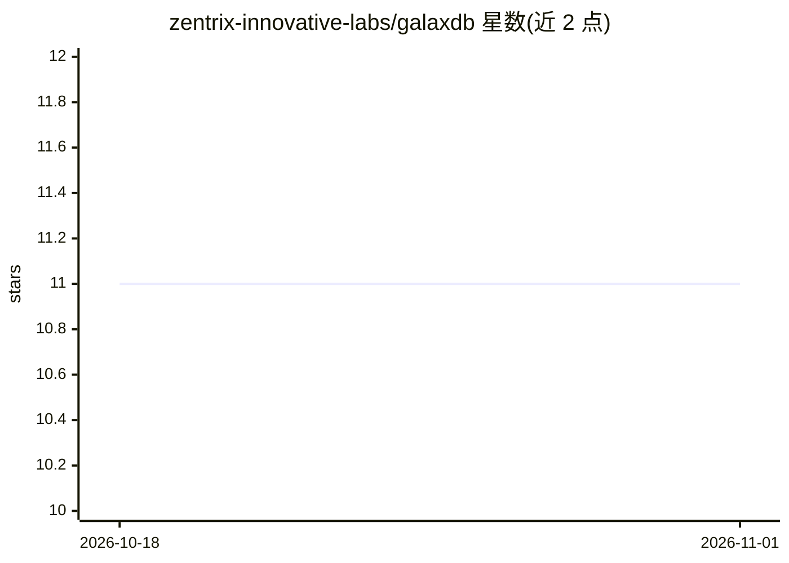

# zentrix-innovative-labs/galaxdb

⭐ 11 · Rust · Apache-2.0 · 推送 2026-07-10 · [GitHub](https://github.com/zentrix-innovative-labs/galaxdb) · [官网](https://galaxdb.com) · 组织维护

**面向 AI/ML 负载的单二进制数据库：SQL+向量检索+训练导出**

用单个约 60 MB 的 galaxdb-server 二进制替代关系数据库、向量库、嵌入 API 与数据管线的组合，讲 PostgreSQL 线协议（端口 5433），现有 psycopg2/SQLAlchemy/pg 代码可直连。提供 AuroraSQL 扩展（SEMANTIC_MATCH、AT VERSION 时间旅行、Lance 训练导出、MinHash 去重），嵌入式 DataFusion 分析引擎与 HNSW 向量检索；可选 sidecar 进程做本地嵌入推理（Unix-only，Windows 下需 WSL2/Docker）。Python 嵌入模式类似 SQLite，另有 Homebrew、安装脚本、Docker 与各平台预编译二进制。安全功能含 AES-256-GCM 静态加密、SCRAM-SHA-256、TLS 与 RBAC；SSO/细粒度 RBAC 属企业版。

## 筛选速览

| 维度 | 判定 | 备注 |
|---|---|---|
| AI 角色 | `ai-ecosystem` | LLM/agent 周边工具 |
| 许可风险 | `permissive` | Apache-2.0 |
| 部署形态 | `desktop` | 安装包/桌面程序 |
| 模型依赖 | — | README 未给出锁定关系 |
| 硬件要求 | — | 无带数字的原话,不猜 |
| 安装摩擦 | `low` | 无编译、无系统依赖或容器化 |
| 成熟度 | — | 结构信号不足 |

## 能力要点

- 单二进制讲 PostgreSQL 线协议，兼容现有 Postgres 客户端
- SEMANTIC_MATCH 语义检索与 SQL 过滤在同一查询中组合
- AT VERSION 时间旅行查询与 Lance 格式训练导出
- 本地嵌入推理 sidecar，无需外部嵌入 API

## 适用场景

- RAG 应用在同一库内存储文档、计算嵌入并做混合检索
- ML 训练管线快照数据并导出 Lance 数据集供 PyTorch 零拷贝加载
- 审计场景复现模型训练所用数据版本
- 时序数据与语义相似度组合查询

## 场景标签

`向量数据库` · 领域:知识与检索

## 证据(README 行号)

> L13: Most AI applications bolt together 3–5 separate services: a relational database, a vector database, an embedding AP
> L151: **RAG applications** — store documents, compute embeddings locally, query with `SEMANTIC_MATCH` filtered by metada
> L153: **ML training pipelines** — `CREATE VERSION TAG ... FOR TRAINING` snapshots your data and exports it as a Lance da

## 星数曲线

2026-10-18 11 → 2026-11-01 11（+0）

---
*卡片 v1 · prompt 1.4 · 生成 2026-11-01 · 置信度 high · 依据 README sha `e45d870c4570` · [字段定义](../../DATASET.md)*
