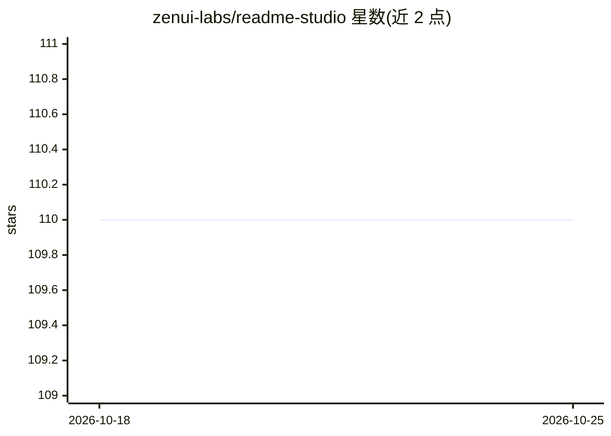

# zenui-labs/readme-studio

⭐ 110 · TypeScript · MIT · 推送 2026-09-29 · [GitHub](https://github.com/zenui-labs/readme-studio) · [官网](https://readmestudio.zenui.net) · 组织维护

**AI 生成 README 的 Web 编辑器，面向开发者文档撰写**

基于 Vue.js + TypeScript + Vite 的 Web 应用，调用 Google Gemini API 生成 README，并提供 Markdown 编辑器、实时预览、预置模板与暗色模式，生成的 README 可编辑。需自行配置 .env 中的 VITE_GOOGLE_API_KEY，否则 AI 生成功能不可用；AI 之外仍是完整的 Markdown 编辑器。通过 git clone 源码 + npm 安装运行，由 zenui-labs 团队维护，MIT 许可。

## 筛选速览

| 维度 | 判定 | 备注 |
|---|---|---|
| AI 角色 | `ai-enhanced` | 去掉 AI 部分产品仍成立 |
| 许可风险 | `permissive` | MIT |
| 部署形态 | `library` | 以包/库形式分发 |
| 模型依赖 | — | README 未给出锁定关系 |
| 硬件要求 | — | 无带数字的原话,不猜 |
| 安装摩擦 | `low` | 无编译、无系统依赖或容器化 |
| 成熟度 | — | 结构信号不足 |

## 能力要点

- AI 生成项目 README
- Markdown 编辑器与实时预览
- 预置 README 模板
- 依赖 Google Gemini API key（VITE_GOOGLE_API_KEY）

## 适用场景

- 为 GitHub 项目快速生成结构化 README
- 在模板基础上编辑与预览 Markdown 文档
- 为个人主页生成 profile README

## 场景标签

`AI 写作` · 领域:内容生成

## 证据(README 行号)

> L10: - AI-powered README generation
> L42:  `VITE_GOOGLE_API_KEY` your google gemini api key (otherwise the readme ai generation will not work).

## 星数曲线

2026-10-18 110 → 2026-10-25 110（+0）

---
*卡片 v1 · prompt 1.4 · 生成 2026-10-23 · 置信度 high · 依据 README sha `d6b628fc7fe1` · [字段定义](../../DATASET.md)*
