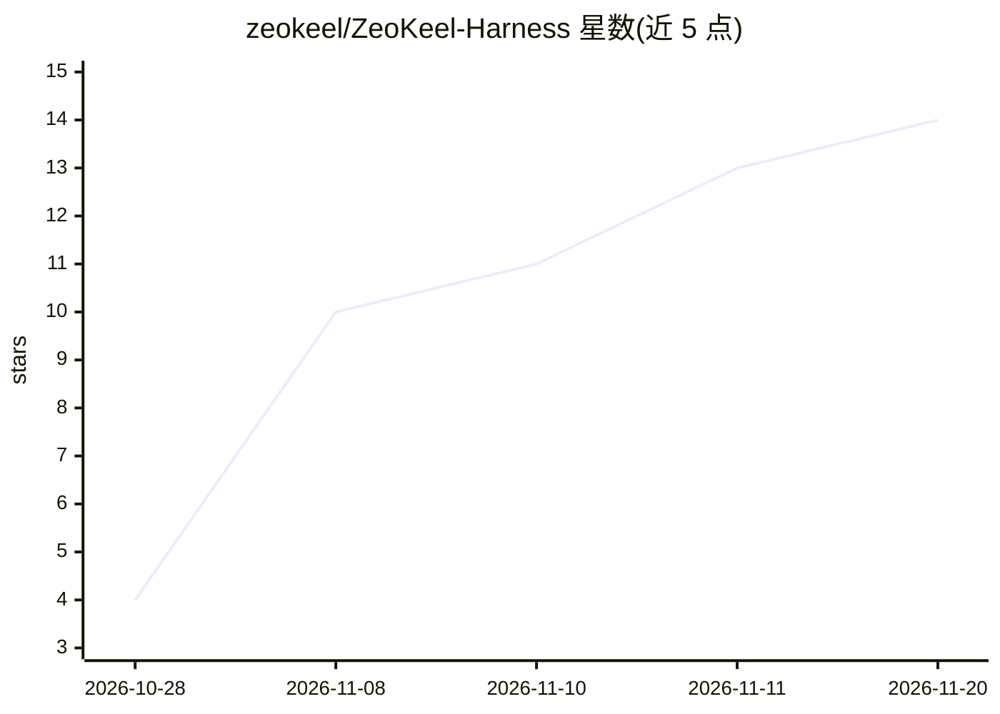

# zeokeel/ZeoKeel-Harness

⭐ 14 · TypeScript · MIT · 推送 2026-11-18 · [GitHub](https://github.com/zeokeel/ZeoKeel-Harness) · [官网](https://www.zeokeel.com) · 组织维护 · 中文 README

**为企业在内网桌面运行 DeepSeek Harness 的客户端+管控台**

基于 deepseek-ai/deepseek-harness 构建的企业级整合平台，将上游固定版本的本地智能体、Host 服务与插件系统打包为三层结构：Electron 桌面客户端（原生窗口、托盘、自动更新）、本机运行的 Harness 服务、Web 管理后台（用户/部门/网关/用量计费/审计）。本地服务自动启停与恢复，凭据与语音识别均在本地处理。上游代码不改，桌面壳与业务能力均通过官方 Cordis 插件机制组合。安装包随服务端镜像分发，支持 Windows x64、macOS Apple Silicon、Linux x64。

## 筛选速览

| 维度 | 判定 | 备注 |
|---|---|---|
| AI 角色 | `ai-ecosystem` | LLM/agent 周边工具 |
| 许可风险 | `permissive` | MIT |
| 部署形态 | `desktop` | 安装包/桌面程序 |
| 模型依赖 | locked-api |  |
| 硬件要求 | — | 无带数字的原话,不猜 |
| 安装摩擦 | `low` | 无编译、无系统依赖或容器化 |
| 成熟度 | — | 结构信号不足 |

## 能力要点

- 桌面客户端+本地 Harness 服务+Web 管理后台三层结构
- 管理后台覆盖用户、部门、网关、用量配额与审计日志
- 一切皆插件：桌面壳本身是 DSH 插件，上游以固定版本原样运行
- 本机离线语音识别与五轨记忆，数据留在本机

## 适用场景

- 企业内网部署 AI 办公智能体，员工无需访问外网即可获得客户端
- 按用户/部门做模型用量计费、限额与审计
- 通过 MCP 连接器（如销售易 NeoCRM）对接企业业务系统

## 场景标签

`AI 助手` · 领域:对话与助手

## 证据(README 行号)

> L15: ZeoKeel Harness 把 DeepSeek Harness 的本地智能体、Host 服务、插件系统与企业级管理能力装进一个平台：
> L19: - **管理后台**：Web 化管理台，覆盖用户、部门、网关、用量、市场与能力中心（共享审批）、审计；
> L135: 本项目基于 deepseek-ai/deepseek-harness 构建。

## 星数曲线

2026-10-28 4 → 2026-11-20 14（+10）

---
*卡片 v1 · prompt 1.4 · 生成 2026-11-18 · 置信度 high · 依据 README sha `e2322b21b025` · [字段定义](../../DATASET.md)*
