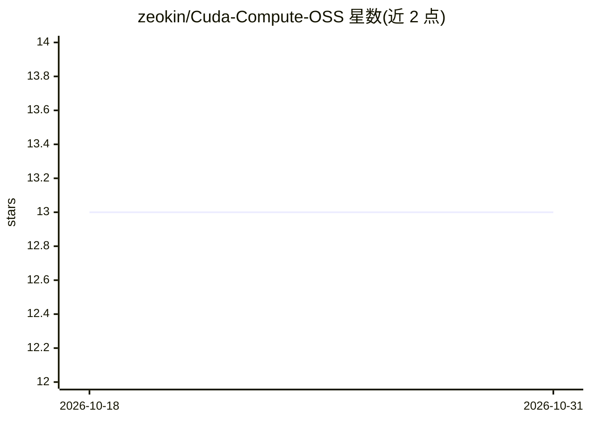

# zeokin/Cuda-Compute-OSS

⭐ 13 · Python · MIT · 推送 2026-08-15 · [GitHub](https://github.com/zeokin/Cuda-Compute-OSS) · [官网](https://zeokin.github.io/Cuda-Compute-Dashboard/) · 个人维护

**面向消费级 NVIDIA GPU 的长上下文 attention 算子优化与基准评测项目**

证据优先的开源项目，研究在消费级 NVIDIA GPU（参考卡 RTX 5070 Ti）上改进精确 attention 的延迟与显存占用。包含 matmul/attention 原型、受保护的基准评测体系（9 种 GPU 工作负载：4 种 prefill、3 种 decode、2 种 guard）、以正确性为硬性门槛、PyTorch SDPA 为生产参照的自动 PR 合并流水线。贡献者 GPU 数据仅作诊断，只有受保护的同机评测可标记、关闭或合并 PR。README 明确声明当前不主张 FFT 替代 attention 或改进 LLM。

## 筛选速览

| 维度 | 判定 | 备注 |
|---|---|---|
| AI 角色 | `ai-ecosystem` | LLM/agent 周边工具 |
| 许可风险 | `permissive` | MIT |
| 部署形态 | `None` |  |
| 模型依赖 | — | README 未给出锁定关系 |
| 硬件要求 | — | 无带数字的原话,不猜 |
| 安装摩擦 | `medium` | 含编译或系统依赖之一 |
| 成熟度 | — | 结构信号不足 |

## 能力要点

- 9 种 GPU 工作负载的受保护基准（prefill/decode/guard 分别判定）
- 正确性为硬门槛的自动 PR 评测与合并流水线（append-only attention ledger）
- exact/local/spectral/correlation/landmark attention 原型代码
- 贡献者不可修改评测与基准基础设施的信任边界设计

## 适用场景

- 在固定 RTX 5070 Ti 环境下参与 attention 算子的延迟/显存优化挑战
- 研究 exact attention、FFT 全局路径等混合算子的基础实现
- 了解带对抗认证与冻结清单的 GPU 基准评测流程设计

## 场景标签

 · 领域:GPU 算子优化/LLM 基础设施

## 证据(README 行号)

> L3: CCO is an evidence-first project for efficient long-context attention on
> L19: |Goal|Improve exact attention latency or memory without correctness loss|
> L61: - PyTorch scaled-dot-product attention as the production reference;

## 星数曲线

2026-10-18 13 → 2026-10-31 13（+0）

---
*卡片 v1 · prompt 1.4 · 生成 2026-10-31 · 置信度 mid · 依据 README sha `bfb4b1be16ab` · [字段定义](../../DATASET.md)*
