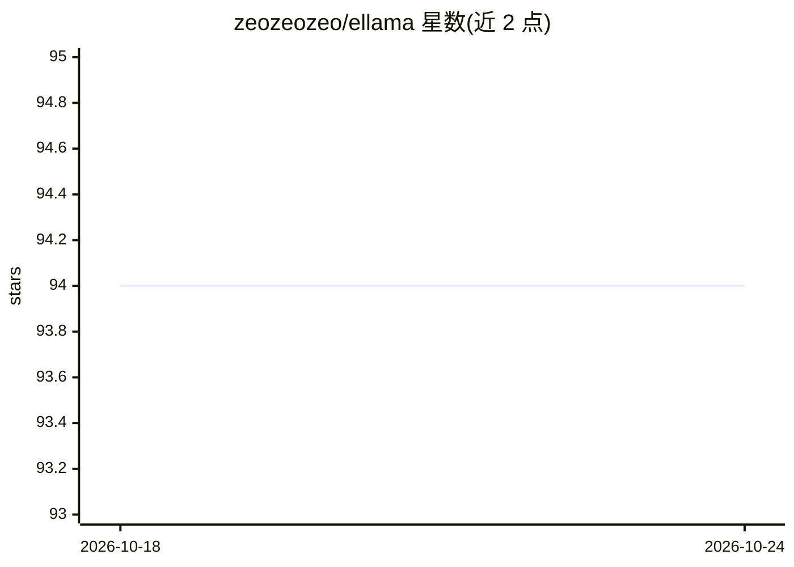

# zeozeozeo/ellama

⭐ 94 · Rust · Apache-2.0 · 推送 2026-04-08 · [GitHub](https://github.com/zeozeozeo/ellama) · [官网](https://zeozeozeo.github.io/ellama/) · 个人维护

**与本地/远程 Ollama 实例对话的桌面聊天界面**

基于 egui 的 Rust 桌面应用，作为现有 Ollama 实例的前端聊天界面：按对话管理聊天历史与模型设置，支持多模态模型（如 LLaVA）的图片输入，可拖拽或粘贴图片，另有可选 TTS 功能（默认关闭，Linux 下启用需 libspeechd）。不做推理本身，需连接已运行的 Ollama 实例（默认 127.0.0.1:11434）。安装方式为下载 Releases 页预编译包或 cargo install 从源码构建。

## 筛选速览

| 维度 | 判定 | 备注 |
|---|---|---|
| AI 角色 | `ai-ecosystem` | LLM/agent 周边工具 |
| 许可风险 | `permissive` | Apache-2.0 |
| 部署形态 | `desktop` | 安装包/桌面程序 |
| 模型依赖 | local-ok | 支持本地模型 |
| 硬件要求 | — | 无带数字的原话,不猜 |
| 安装摩擦 | `low` | 无编译、无系统依赖或容器化 |
| 成熟度 | — | 结构信号不足 |

## 能力要点

- 按对话创建/删除/编辑聊天与模型设置
- 支持多模态模型（LLaVA 等）的图片输入
- 复用现有 Ollama 实例，无需另装推理引擎
- 可选 TTS 功能（cargo build --features tts，默认关闭）

## 适用场景

- 给本地或远程 Ollama 实例配一个图形聊天界面
- 在桌面端用多模态模型进行带图片的对话
- 低资源占用下与本地模型聊天

## 场景标签

`聊天机器人` · 领域:对话与助手

## 证据(README 行号)

> L3: Ellama is a friendly interface to chat with a local or remote Ollama instance.
> L11: - **Ollama**: no need to install new inference engines, connect to a regular Ollama instance instead.

## 星数曲线

2026-10-18 94 → 2026-10-24 94（+0）

---
*卡片 v1 · prompt 1.4 · 生成 2026-10-23 · 置信度 high · 依据 README sha `631b3f3c02f6` · [字段定义](../../DATASET.md)*
