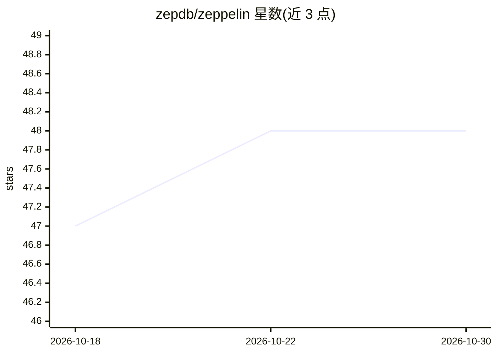

# zepdb/zeppelin

⭐ 48 · Rust · Apache-2.0 · 推送 2026-08-16 · [GitHub](https://github.com/zepdb/zeppelin) · 组织维护

**S3 原生的向量与全文混合检索引擎，节点无状态、可自托管**

Rust 编写的自托管检索引擎：向量（IVF-Flat 分区 + 2-bit Extended-RaBitQ 量化 + 精确 f32 重排）、BM25 全文（倒排索引、可配置分词）、多向量 MaxSim 晚交互与 RoaringBitmap 属性过滤。对象存储是唯一数据真源，节点无状态、任意节点可服务任意命名空间，支持 S3/MinIO/GCS/Azure Blob 后端与按查询选择强/最终一致性。提供 Docker Compose 快速启动、HTTP API、OpenAPI 3.1 规范、RBAC 与审计日志。限制：pre-1.0，磁盘格式无稳定性保证；GCS/Azure 仅经模拟器测试；性能数据为回环 MinIO 测量。

## 筛选速览

| 维度 | 判定 | 备注 |
|---|---|---|
| AI 角色 | `ai-ecosystem` | LLM/agent 周边工具 |
| 许可风险 | `permissive` | Apache-2.0 |
| 部署形态 | `self-host` | docker 或自建部署 |
| 模型依赖 | — | README 未给出锁定关系 |
| 硬件要求 | — | 无带数字的原话,不猜 |
| 安装摩擦 | `low` | 无编译、无系统依赖或容器化 |
| 成熟度 | `idea` | |

## 能力要点

- 向量 + BM25 全文 + 晚交互多向量混合检索
- 对象存储为唯一真源、节点无状态的 S3 原生架构
- 2-bit Extended-RaBitQ 量化与精确 f32 重排为生产默认
- zeppelin_advisor 根据数据形状给出硬件选型与已验证配置

## 适用场景

- 用 S3/MinIO 作为存储底座自托管向量检索服务
- 在成本敏感场景下替代 SSD+内存常驻的向量数据库部署
- 需要向量、全文与属性过滤组合查询的检索场景

## 场景标签

`向量数据库` · 领域:知识与检索

## 证据(README 行号)

> L10:  An S3-native vector search engine. Object storage is the source of truth. Nodes are stateless.
> L32: - **BM25 full-text search** -- Inverted indexes with configurable tokenization, stemming, and multi-field `rank_by`

## 星数曲线

2026-10-18 47 → 2026-10-30 48（+1）

---
*卡片 v1 · prompt 1.4 · 生成 2026-10-25 · 置信度 high · 依据 README sha `ee7dd80476e8` · [字段定义](../../DATASET.md)*
