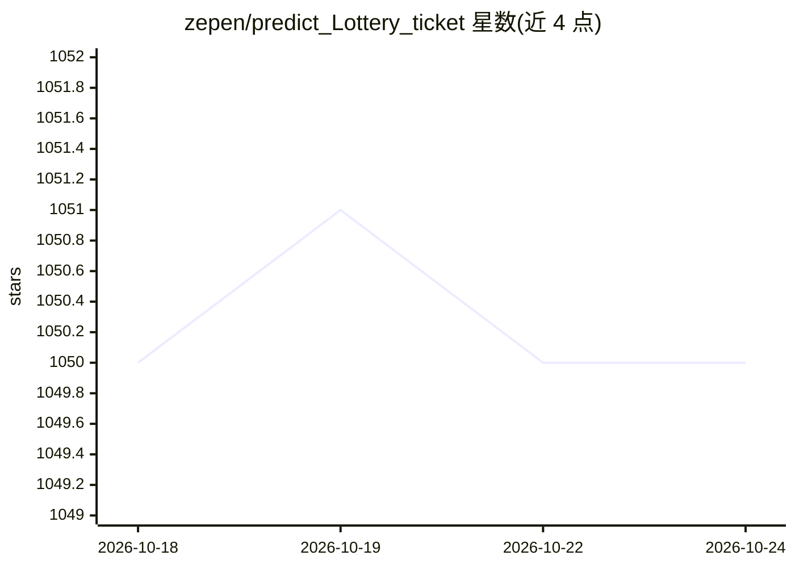

# zepen/predict_Lottery_ticket

⭐ 1,050 · Python · 推送 2026-09-10 · [GitHub](https://github.com/zepen/predict_Lottery_ticket) · [官网](https://www.ai-spinach.xyz) · 个人维护 · 中文 README

**基于 LSTM+CRF 的彩票号码预测实验项目**

深度学习彩票号码预测实验项目，声明仅供娱乐。将红球号码作为完整序列建模，用 LSTM+CRF 捕捉号码间序列依赖以避免独立预测的重复号码问题，蓝球单独建模。基于 TensorFlow 1.x 兼容模式在 2.x 下经 tf.compat.v1 运行，需 Python 3.11 与 conda 环境。支持双色球、大乐透、七乐彩、七星彩，脚本化运行，另提供在线训练预测 Web 应用；爬虫采用 curl_cffi 获取历史数据。

## 筛选速览

| 维度 | 判定 | 备注 |
|---|---|---|
| AI 角色 | `ai-native` | 本体是模型或模型工具 |
| 许可风险 | `none` | — |
| 部署形态 | `library` | 以包/库形式分发 |
| 模型依赖 | — | README 未给出锁定关系 |
| 硬件要求 | — | 无带数字的原话,不猜 |
| 安装摩擦 | `low` | 无编译、无系统依赖或容器化 |
| 成熟度 | — | 结构信号不足 |

## 能力要点

- 红球 LSTM+CRF 序列建模，避免独立预测的重复号码问题
- 支持双色球、大乐透、七乐透、七星彩四类彩种
- 纯脚本化运行，无需 Docker 或微服务
- 提供在线训练预测 Web 应用

## 适用场景

- 我训练模型生成下一期彩票号码预测
- 我调整训练集/测试集比例做预测评估
- 我不想本地部署，直接在网页上训练预测

## 场景标签

 · 领域:AI 娱乐/实验项目

## 证据(README 行号)

> L12: 本项目是一个基于深度学习的彩票号码预测实验项目，**仅供娱乐，请勿用于任何非法用途或过度投注。**
> L14: 项目的核心是**序列模型的预测能力**。与传统将每个号码独立预测不同，本项目将红球号码视为一个完整的序列进行建模，并引入 **CRF（条件随机场）** 层来捕捉号码之间的序列依赖关系。这种方式能有效避免独立预测产生的重复号码问题，

## 星数曲线

2026-10-18 1,050 → 2026-10-24 1,050（+0）

---
*卡片 v1 · prompt 1.4 · 生成 2026-10-21 · 置信度 high · 依据 README sha `3d9ce5feba2c` · [字段定义](../../DATASET.md)*
