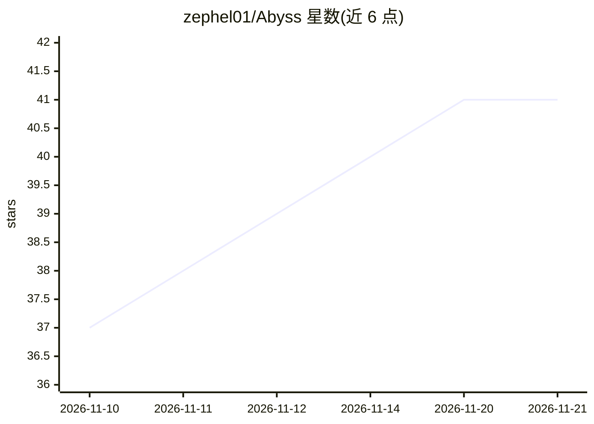

# zephel01/Abyss

⭐ 41 · C++ · MIT · 推送 2026-11-20 · [GitHub](https://github.com/zephel01/Abyss) · [官网](https://huggingface.co/zephel01) · 个人维护

**单张消费级 GPU 上运行超大 MoE 模型的推理引擎**

Project Maya 的分支，面向单台 PC 的大型混合专家（MoE）模型推理：将最常用专家留在 VRAM、次常用放 pinned RAM、其余放 NVMe SSD，按对话需要动态搬运，使超出显存的模型可用速度运行。提供浏览器聊天界面与 OpenAI/Anthropic 兼容 API，支持思考与工具调用。附一条命令安装脚本（含模型下载、校验、按 GPU 编译引擎、校准 CPU lane/PCIe 分配），并有性能监控仪表板。支持 CUDA 与 ROCm（AMD 实验性），无编译器时可下载预编译引擎。

## 筛选速览

| 维度 | 判定 | 备注 |
|---|---|---|
| AI 角色 | `ai-ecosystem` | LLM/agent 周边工具 |
| 许可风险 | `permissive` | MIT |
| 部署形态 | `None` |  |
| 模型依赖 | local-ok | 支持本地模型 |
| 硬件要求 | — | 无带数字的原话,不猜 |
| 安装摩擦 | `medium` | 含编译或系统依赖之一 |
| 成熟度 | `idea` | |

## 能力要点

- 专家按热度分层于 VRAM / pinned RAM / NVMe SSD，支持 50-280 GB MoE 模型
- OpenAI 与 Anthropic 兼容 API 及浏览器聊天界面，支持思考与工具调用
- setup 脚本自动检测 PC 规格、下载模型、按 GPU 编译并校准（约 +12% 于 RTX 4090）
- 支持 NVIDIA CUDA、AMD HIP（实验性）与 DGX Spark（ARM64，beta）

## 适用场景

- 在 12-32 GB 显存的家用 PC 上跑 DeepSeek/GLM/Qwen 等超大 MoE 模型
- 本地部署带 OpenAI/Anthropic 兼容 API 的服务供其他应用接入
- 通过仪表板观察解码速度与各层专家命中情况

## 场景标签

`推理引擎` · 领域:训练与推理

## 证据(README 行号)

> L19: Abyss is an inference engine for large mixture-of-experts (MoE) models on one PC. It keeps the most-used experts in
> L21: model larger than your GPU runs at usable speed. You get a browser chat and OpenAI- / Anthropic-compatible APIs, wi

## 星数曲线

2026-11-10 37 → 2026-11-21 41（+4）

---
*卡片 v1 · prompt 1.4 · 生成 2026-11-18 · 置信度 high · 依据 README sha `111ab7f20b22` · [字段定义](../../DATASET.md)*
