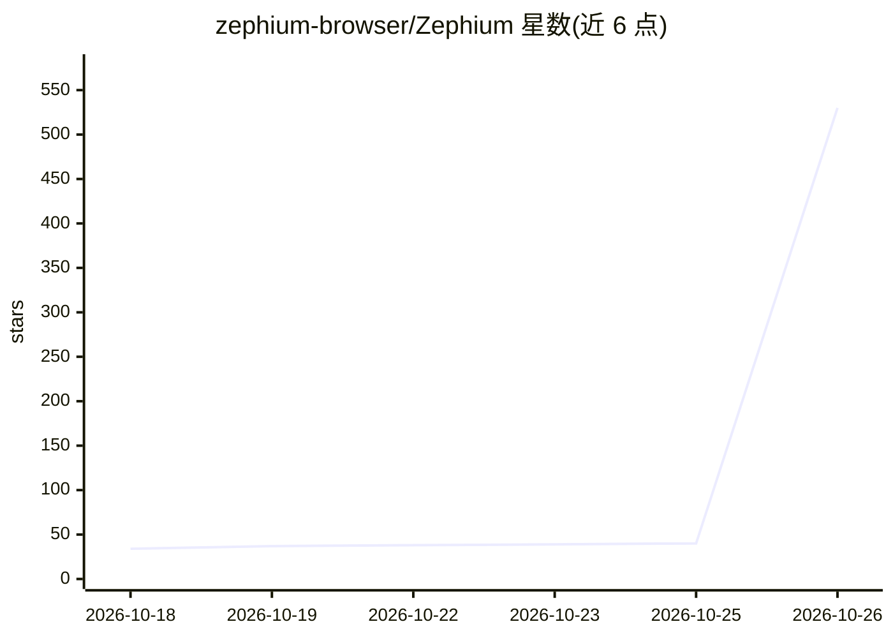

# zephium-browser/Zephium

⭐ 530 · Rust · MPL-2.0 · 推送 2026-10-25 · [GitHub](https://github.com/zephium-browser/Zephium) · [官网](https://zephium.app) · 组织维护 · 中文 README

**面向用户与 AI agent 的 Rust 开源浏览器，含 Work 画布模式**

用 Rust 构建的开源浏览器，macOS 用系统 WebKit、Windows 用 WebView2，非 Chromium/Firefox 分支；内置广告与跟踪拦截（基于 Brave 的 adblock-rust），支持安装 Chrome 扩展，附带任务、时间统计和 Markdown 笔记功能。其 Work 模式在画布上运行多个 agent 助手并行执行任务（如比价、规划行程），可读写授权文件夹、运行命令、连接 MCP 服务器；模型通过用户自有 API key（Anthropic/OpenAI/Gemini 等）或本地 Ollama/LM Studio 接入，密钥存于系统钥匙串。目前处 beta，仅支持 macOS（Apple Silicon）与 Windows x64。

## 筛选速览

| 维度 | 判定 | 备注 |
|---|---|---|
| AI 角色 | `ai-enhanced` | 去掉 AI 部分产品仍成立 |
| 许可风险 | `permissive` | MPL-2.0 |
| 部署形态 | `desktop` | 安装包/桌面程序 |
| 模型依赖 | local-ok | 支持本地模型 |
| 硬件要求 | — | 无带数字的原话,不猜 |
| 安装摩擦 | `low` | 无编译、无系统依赖或容器化 |
| 成熟度 | `idea` | |

## 能力要点

- Work 画布模式：多个 agent 助手并行浏览与执行任务，步骤可视化
- 原生广告与跟踪拦截（Brave adblock-rust + EasyList/EasyPrivacy）
- 自带模型 key 或本地 Ollama/LM Studio 接入，密钥存系统钥匙串
- 支持从 Chrome Web Store 安装 Chrome 扩展，20 个常用扩展已验证

## 适用场景

- 日常浏览网页并屏蔽广告与跟踪器
- 让多个 AI 助手在画布上并行完成调研、比价、规划等任务
- 在浏览器内统一管理任务、笔记与上网时间

## 场景标签

`AI 助手` `浏览器自动化` · 领域:效率与自动化

## 证据(README 行号)

> L31: Zephium is an open-source browser built in Rust on your operating system's own
> L37: One switch away is **Work**. Your work already happens in the browser, where

## 星数曲线

2026-10-18 34 → 2026-10-26 530（+496）

---
*卡片 v1 · prompt 1.4 · 生成 2026-10-25 · 置信度 mid · 依据 README sha `2674cfc4588f` · [字段定义](../../DATASET.md)*
