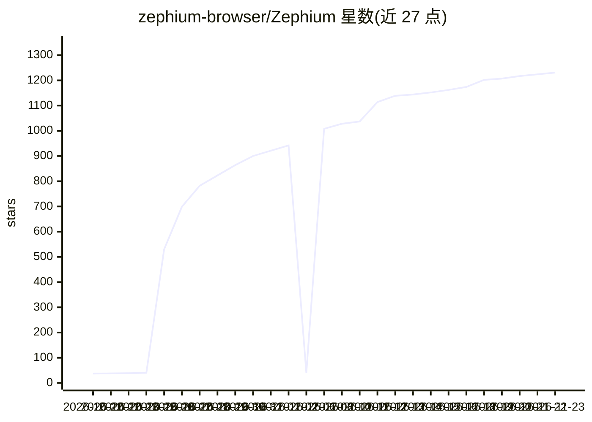

# zephium-browser/Zephium

⭐ 1,231 · Rust · MPL-2.0 · 推送 2026-11-22 · [GitHub](https://github.com/zephium-browser/Zephium) · [官网](https://zephium.app) · 组织维护

**面向用户与 agent 的开源浏览器，AI 在画布上协作完成任务**

以 Rust 与 Tauri 构建、运行于系统原生 WebKit（macOS）与 WebView2（Windows）的开源浏览器，非 Chromium/Firefox 分支。浏览器本体提供原生广告拦截（基于 Brave 的 adblock-rust）、Chrome 扩展兼容、任务/笔记/时间统计、垂直标签页与启动器。AI 部分包括 Work 画布（agent 并行执行并展示步骤）、侧边栏 Ask Zephium 页面助手、25 个内置技能与 MCP 集成。提供 macOS/Windows 安装包，需 macOS 14+ 或 Windows 10+。

## 筛选速览

| 维度 | 判定 | 备注 |
|---|---|---|
| AI 角色 | `ai-enhanced` | 去掉 AI 部分产品仍成立 |
| 许可风险 | `permissive` | MPL-2.0 |
| 部署形态 | `desktop` | 安装包/桌面程序 |
| 模型依赖 | local-ok | 支持本地模型 |
| 硬件要求 | — | 无带数字的原话,不猜 |
| 安装摩擦 | `low` | 无编译、无系统依赖或容器化 |
| 成熟度 | — | 结构信号不足 |

## 能力要点

- Work 画布：多 helper 并行执行任务并逐步展示过程
- 接入 MCP 服务器（Linear/Notion/Sentry 等）与本地文件/命令行
- 支持自定义 API key、本地模型（Ollama/LM Studio）或 Zephium AI 托管
- 原生广告与追踪器拦截，默认开启

## 适用场景

- 用自然语言在浏览器里让 agent 规划行程、比价、做调研
- 浏览网页时用侧边栏助手读取并操作当前页面
- 需要非 Chromium 内核且原生拦截广告的桌面浏览器

## 场景标签

`浏览器自动化` `AI 助手` · 领域:效率与自动化

## 证据(README 行号)

> L39: Zephium is an open-source browser built in Rust on your operating system's own
> L45: One switch away is **Work**. Your work already happens in the browser, where
> L76: - **Bring any model.** Use your own keys for Anthropic, OpenAI, Google Gemini,

## 星数曲线

2026-10-21 37 → 2026-11-23 1,231（+1,194）

---
*卡片 v1 · prompt 1.4 · 生成 2026-11-23 · 置信度 mid · 依据 README sha `3d9c49d2c100` · [字段定义](../../DATASET.md)*
