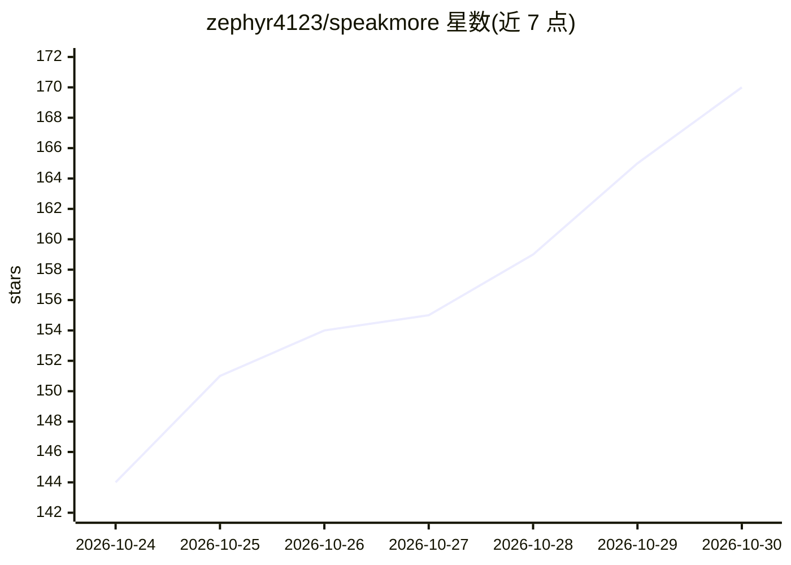

# zephyr4123/speakmore

⭐ 170 · JavaScript · MIT · 推送 2026-10-29 · [GitHub](https://github.com/zephyr4123/speakmore) · [官网](https://speakmore.zephyrxiang.com) · 个人维护 · 中文 README

**面向普通用户的语音输入与划词翻译桌面工具（Mac/Windows）**

常驻菜单栏的桌面应用，提供三项快捷键功能：语音输入（口述整理为文字写入光标处）、语音翻译（口述直接译出目标语言）、划词翻译（任意应用中选中文字显示译文卡片）。识别支持直出/混合/离线三种方式，离线方式由本机模型（Qwen3-ASR、SenseVoice，Metal/Vulkan/CPU）转文字，不上传数据；云端接入 Gemini、OpenAI、通义千问、DeepSeek、Kimi、智谱 GLM、MiniMax 及 OpenAI 兼容服务。附 CLI，功能与 App 对等。MIT 许可，附对 Typeless 的逆向笔记。

## 筛选速览

| 维度 | 判定 | 备注 |
|---|---|---|
| AI 角色 | `ai-native` | 本体是模型或模型工具 |
| 许可风险 | `permissive` | MIT |
| 部署形态 | `library` | 以包/库形式分发 |
| 模型依赖 | local-ok | 支持本地模型 |
| 硬件要求 | — | 无带数字的原话,不猜 |
| 安装摩擦 | `low` | 无编译、无系统依赖或容器化 |
| 成熟度 | — | 结构信号不足 |

## 能力要点

- 三种识别方式并列可选，离线方式完全本机运行无需密钥
- 支持 9 家厂商及 OpenAI 兼容服务，语音与划词模型独立配置
- 本机模型经 Metal/Vulkan/CPU 运行，Qwen3-ASR 0.6B 单条转文字中位数 231–240 毫秒
- CLI 与 App 功能对等，支持 --json 输出与词典导入

## 适用场景

- 在任意应用中口述成文，自动去除语气词并整理输出
- 与外国同事交流时口述直接译成英文/日文写入输入框
- 阅读英文论文或文档时划词即译，无需另开翻译工具
- 希望语音输入完全离线、不上传数据的使用方式

## 场景标签

`语音识别` · 领域:感知与多模态

## 证据(README 行号)

> L7:  语音输入、语音翻译、划词翻译，各由一个快捷键触发，在任意应用中可用。
> L26: |🎙️ **语音输入**|口述，整理为通顺的文字后写入光标处|右 ⌥|右 Alt|
> L38: - 三种识别方式并列可选，离线方式完全在本机运行，不上传任何数据。

## 星数曲线

2026-10-24 144 → 2026-10-30 170（+26）

---
*卡片 v1 · prompt 1.4 · 生成 2026-10-24 · 置信度 mid · 依据 README sha `8f1bb2733a7d` · [字段定义](../../DATASET.md)*
