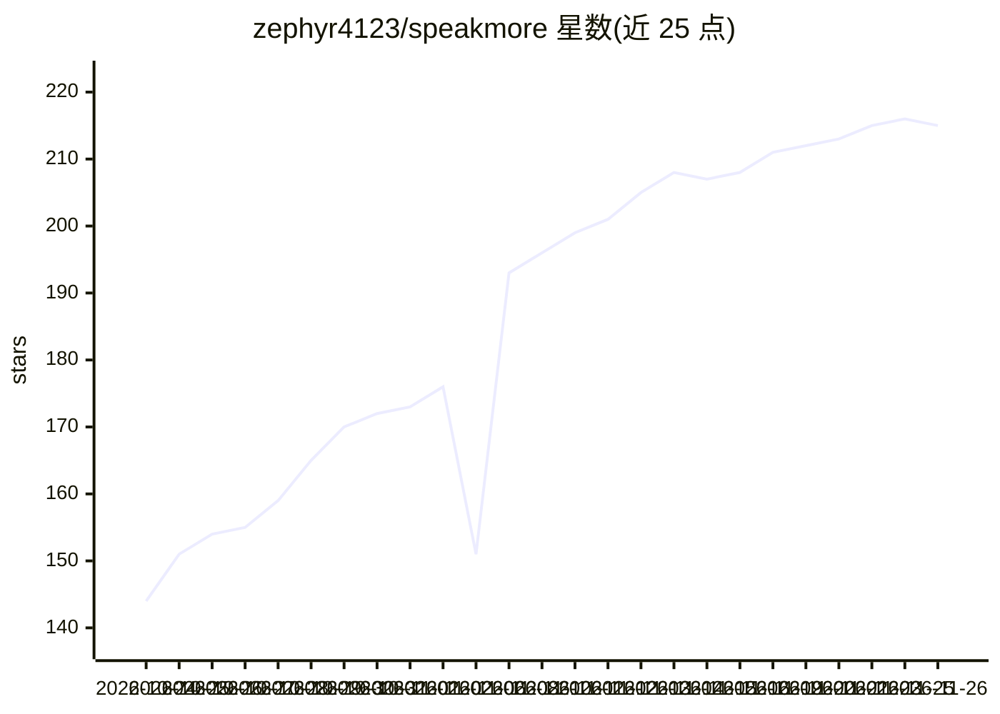

# zephyr4123/speakmore

⭐ 215 · JavaScript · MIT · 推送 2026-11-09 · [GitHub](https://github.com/zephyr4123/speakmore) · [官网](https://speakmore.zephyrxiang.com) · 个人维护 · 中文 README

**开源语音输入与划词翻译工具：口述成文、划词即译**

Electron 桌面应用，提供语音输入、语音翻译（16 种目标语言）与划词翻译三项功能，均由快捷键在任意应用中触发。语音识别有直出、混合、离线三种方式，离线方式用本机模型（Qwen3-ASR/SenseVoice）经 Metal、Vulkan 或 CPU 运行，不上传数据；云端接入 Gemini、OpenAI、通义千问、DeepSeek、Kimi、智谱、MiniMax 等。附 speakmore 命令行工具与功能对等的 CLI 命令，提供 dmg/exe 安装包与终端安装脚本，MIT 许可。附对 Typeless 的 18 篇逆向分析笔记。

## 筛选速览

| 维度 | 判定 | 备注 |
|---|---|---|
| AI 角色 | `ai-native` | 本体是模型或模型工具 |
| 许可风险 | `permissive` | MIT |
| 部署形态 | `library` | 以包/库形式分发 |
| 模型依赖 | locked-api |  |
| 硬件要求 | — | 无带数字的原话,不猜 |
| 安装摩擦 | `low` | 无编译、无系统依赖或容器化 |
| 成熟度 | — | 结构信号不足 |

## 能力要点

- 三种识别方式并列可选：直出、混合、完全离线（本机模型不上传数据）
- 词典机制：专有名词与术语按自定义写法输出
- 本机模型经 Metal/Vulkan/CPU 加速，国内默认魔搭下载源
- 附带功能对等的 speakmore 命令行工具与 --json 输出

## 适用场景

- 在任意输入框用快捷键口述，自动整理成通顺文字
- 群聊或写英文邮件时用中文口述直接输出外文
- 在网页、PDF、终端中选中英文即时查看中文译文
- 隐私敏感场景下用纯离线方式做语音输入

## 场景标签

`语音识别` · 领域:感知与多模态

## 证据(README 行号)

> L6:  开源、免费的语音输入与翻译工具，支持 macOS 与 Windows。
> L26: |🎙️ **语音输入**|口述，整理为通顺的文字后写入光标处|右 ⌥|右 Alt|
> L225: - **直出 7 个**：音频输入，文字输出；语音翻译时直接输出目标语言。

## 星数曲线

2026-10-24 144 → 2026-11-26 215（+71）

---
*卡片 v1 · prompt 1.4 · 生成 2026-11-25 · 置信度 high · 依据 README sha `c13647365865` · [字段定义](../../DATASET.md)*
