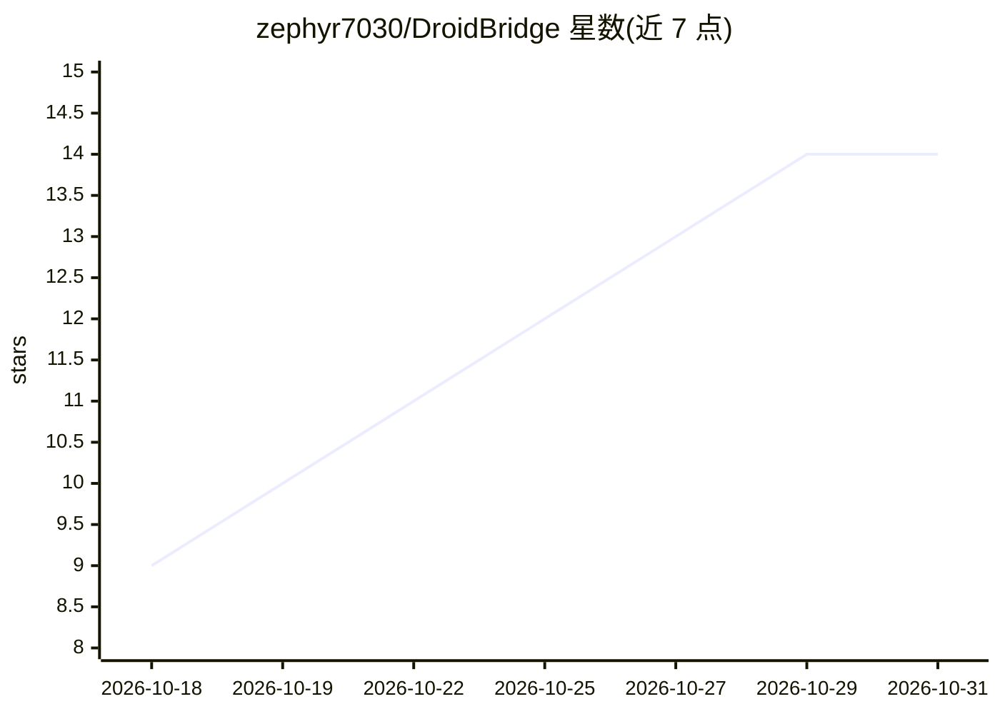

# zephyr7030/DroidBridge

⭐ 14 · Rust · Apache-2.0 · 推送 2026-10-20 · [GitHub](https://github.com/zephyr7030/DroidBridge) · 个人维护 · 中文 README

**Android 设备端 MCP 服务器：让 AI agent 直接操作手机并跑定时自动化**

在 Android 手机上运行的 MCP 服务器，分 App 版（Accessibility/Shizuku）与 Root 版（Magisk/KernelSU/APatch）。手机通过 OpenAI 官方 Secure MCP Tunnel 轮询 HTTPS 连接 ChatGPT，无需开放端口、公网地址或 PC/ADB；也可在 127.0.0.1:8765 提供 Bearer Token 保护的本地 MCP 端点。提供 visual/android/filesystem/command/network/automation 等 8 类工具，自动化任务保存于设备、按时间/日历/事件触发持续运行，无需 agent 在场。要求 Android 13–17、arm64-v8a（App 版另含 x86_64 库）。无自建服务器、无遥测，Apache-2.0 许可。

## 筛选速览

| 维度 | 判定 | 备注 |
|---|---|---|
| AI 角色 | `ai-ecosystem` | LLM/agent 周边工具 |
| 许可风险 | `permissive` | Apache-2.0 |
| 部署形态 | `desktop` | 安装包/桌面程序 |
| 模型依赖 | — | README 未给出锁定关系 |
| 硬件要求 | — | 无带数字的原话,不猜 |
| 安装摩擦 | `medium` | 含编译或系统依赖之一 |
| 成熟度 | — | 结构信号不足 |

## 能力要点

- 设备端 MCP 服务器，通过 OpenAI Secure MCP Tunnel 连接 ChatGPT，无需 PC/ADB/公网
- 8 类 MCP 工具（屏幕操作、应用管理、文件、命令、网络、自动化等）并带安全注解
- 自动化任务保存在设备上，按时间/RRULE 日历/事件触发，脱离 agent 持续运行
- 双版本：App 版（Shizuku 增强）与 Root 版（开机自启、可 root 执行、流量捕获注入）

## 适用场景

- 让 ChatGPT 通过 MCP 直接操作我的安卓手机完成操作
- 设置定时或事件触发的手机自动化任务，无需持续对话
- 在电脑上通过 adb forward 接入本地 MCP 客户端操作手机

## 场景标签

`GUI 自动化` `工作流自动化` · 领域:效率与自动化

## 证据(README 行号)

> L5:  An on-device MCP server for Android.
> L40: |**Local MCP**|Agents on the same device, or on a computer over `adb forward`|Streamable HTTP on `127.0.0.1:8765/mc
> L45: |`context`|DroidBridge status, capabilities and the tool catalog|

## 星数曲线

2026-10-18 9 → 2026-10-31 14（+5）

---
*卡片 v1 · prompt 1.4 · 生成 2026-10-31 · 置信度 high · 依据 README sha `958dac4ff9db` · [字段定义](../../DATASET.md)*
