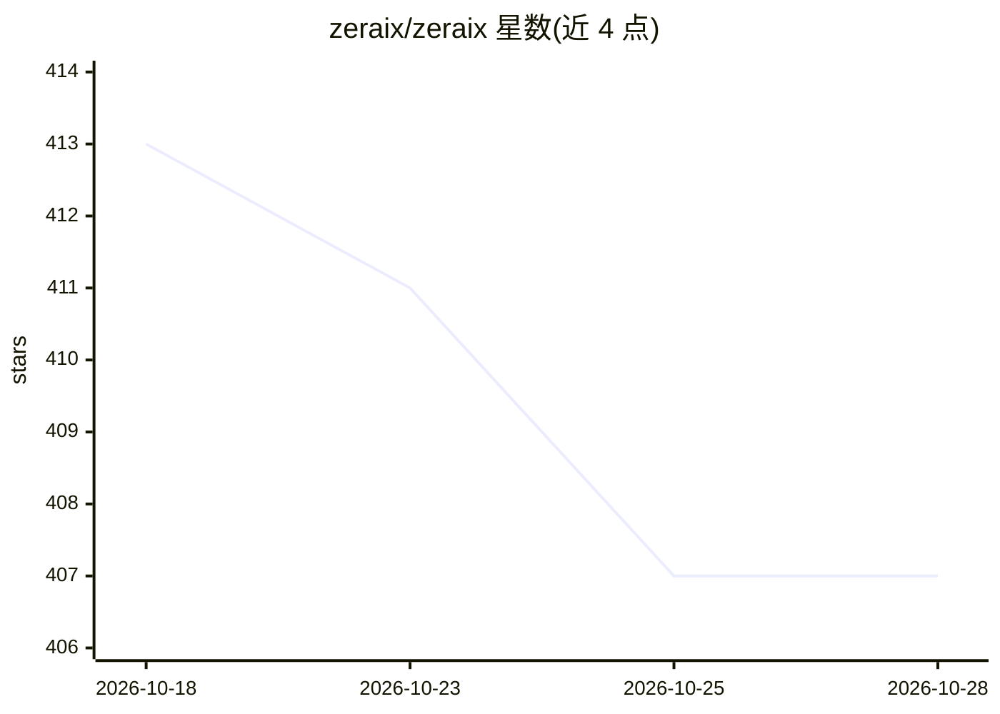

# zeraix/zeraix

⭐ 407 · TypeScript · Apache-2.0 · 推送 2026-10-19 · [GitHub](https://github.com/zeraix/zeraix) · [官网](https://zeraix.com) · 组织维护

**开源本地 AI 桌面工作台：本机运行模型、文件、工具与 Agent**

基于 Electron/Next.js 与 Rust Agent Runtime 的桌面应用，在本机运行 GGUF 等模型并集成对话、文件读写、终端命令、浏览器工具、子 Agent 委派、定时任务与文档 Skills（Word/PDF/演示文稿/表格）。本地推理采用 llama.cpp 系运行时，含 Apple Silicon 调优路径；可选接入 MCP 服务器、插件、OpenAI 兼容端点与云端模型。提供 macOS（Apple Silicon，13+）与 Windows 10/11 x64 安装包，建议 16GB 内存。配套 Imparo 推理引擎为独立项目，尚未成为默认引擎。

## 筛选速览

| 维度 | 判定 | 备注 |
|---|---|---|
| AI 角色 | `ai-native` | 本体是模型或模型工具 |
| 许可风险 | `permissive` | Apache-2.0 |
| 部署形态 | `desktop` | 安装包/桌面程序 |
| 模型依赖 | local-ok | 支持本地模型 |
| 硬件要求 | — | 无带数字的原话,不猜 |
| 安装摩擦 | `low` | 无编译、无系统依赖或容器化 |
| 成熟度 | — | 结构信号不足 |

## 能力要点

- 本地运行 GGUF 模型，硬件感知推荐与运行时管理，无需账号/API key
- Rust Agent Runtime 执行文件/终端/浏览器工具，四种审批模式与 QEMU 沙箱
- 内置 Word/PDF/演示文稿/表格文档 Skills 与媒体库
- 支持本地/远程 MCP 服务器、插件目录与自定义 OpenAI 兼容端点

## 适用场景

- 在本机离线运行模型处理项目文件与多步任务
- 通过子 Agent 与审批模式委派并控制自动化工作
- 用内置 Skills 直接处理办公文档

## 场景标签

`AI 助手` `文档解析` · 领域:对话与助手

## 证据(README 行号)

> L7: Zeraix is an open-source AI desktop for working with models, files, tools, and agents—with local inference at its co
> L30: - **Local models at the center.** Download and run supported GGUF models with hardware-aware recommendations and ru
> L98: The desktop currently uses **llama.cpp-based runtimes** for general local inference. Zeraix's tuned Apple Silicon p

## 星数曲线

2026-10-18 413 → 2026-10-28 407（-6）

---
*卡片 v1 · prompt 1.4 · 生成 2026-10-22 · 置信度 mid · 依据 README sha `868704b88f6d` · [字段定义](../../DATASET.md)*
