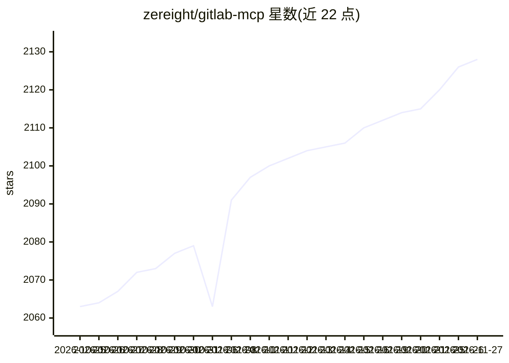

# zereight/gitlab-mcp

⭐ 2,128 · TypeScript · MIT · 推送 2026-11-26 · [GitHub](https://github.com/zereight/gitlab-mcp) · [官网](https://zereight.github.io/gitlab-mcp/) · 个人维护

**给 AI 客户端接入 GitLab 的 MCP 服务器，提供 291 个 GitLab 操作工具**

通过 stdio/SSE/Streamable HTTP 三种传输方式向 MCP 客户端暴露 GitLab REST/GraphQL API 操作，覆盖项目、合并请求、issue、流水线、wiki、发布、标签、里程碑等；默认仅加载 40 个 core 工具以控制发送给模型的 schema token（约 12k），可调用 discover_tools 按会话激活更多类别。支持 PAT、本地 OAuth2、MCP OAuth 代理与远程授权四种认证；另提供 Skill + CLI 平行路径，可在终端直接执行完整负载。MIT 许可，需 Node.js >=20。

## 筛选速览

| 维度 | 判定 | 备注 |
|---|---|---|
| AI 角色 | `ai-ecosystem` | LLM/agent 周边工具 |
| 许可风险 | `permissive` | MIT |
| 部署形态 | `desktop` | 安装包/桌面程序 |
| 模型依赖 | — | README 未给出锁定关系 |
| 硬件要求 | — | 无带数字的原话,不猜 |
| 安装摩擦 | `low` | 无编译、无系统依赖或容器化 |
| 成熟度 | — | 结构信号不足 |

## 能力要点

- 291 个工具（默认 40 个 core 工具，discover_tools 按需激活）
- stdio / SSE / Streamable HTTP 三种传输方式
- PAT、本地 OAuth2、MCP OAuth、远程授权四种认证方式
- 内置 Skill + CLI 路径，无需 MCP 注册即可使用

## 适用场景

- 在 Claude Code / Cursor 等 IDE 客户端中审查合并请求的变更文件与 diff
- 让 AI agent 分页读取流水线作业日志并分析失败原因
- 团队部署共享 HTTP MCP 服务，各用户用自己的 token 访问 GitLab

## 场景标签

 · 领域:开发者工具/AI 集成

## 证据(README 行号)

> L139: **Agent-workflow-optimized GitLab MCP** — manage projects, merge requests, issues, pipelines, wiki, releases, tags
> L20: **Default: 40 tools** (38 `core` + `discover_tools` + `help`). 291 tools exist in total (288 in toolsets + `execute
> L149: - **Multiple transports** — stdio for local clients, SSE for legacy clients, and Streamable HTTP for modern remote

## 星数曲线

2026-10-25 2,063 → 2026-11-27 2,128（+65）

---
*卡片 v1 · prompt 1.4 · 生成 2026-11-27 · 置信度 mid · 依据 README sha `4050657399b7` · [字段定义](../../DATASET.md)*
