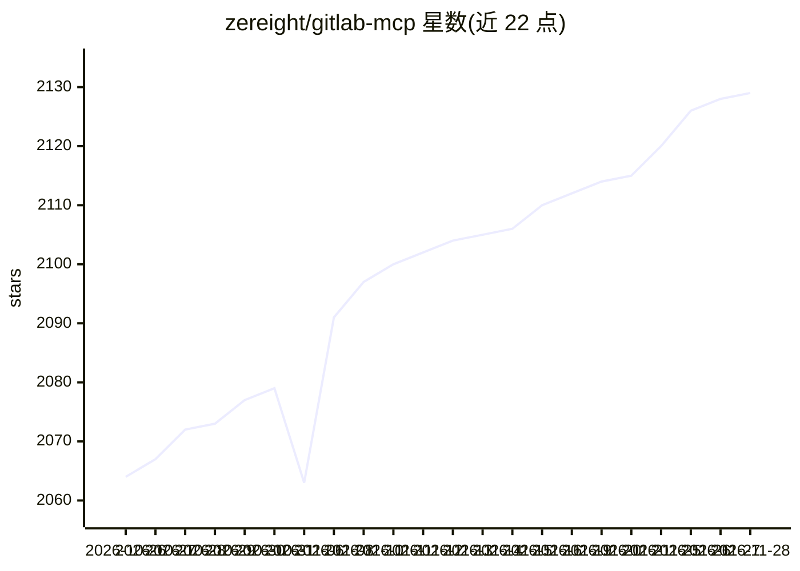

# zereight/gitlab-mcp

⭐ 2,129 · TypeScript · MIT · 推送 2026-11-27 · [GitHub](https://github.com/zereight/gitlab-mcp) · [官网](https://zereight.github.io/gitlab-mcp/) · 个人维护

**面向 AI agent 的 GitLab MCP 服务器，覆盖项目/MR/issue/流水线等操作**

基于 Node.js（>=20）的 GitLab MCP 服务器，通过 GitLab REST/GraphQL API 提供共 291 个工具（默认启用约 40 个，其余按需通过 discover_tools 激活），覆盖项目、合并请求、issue、流水线、wiki、release、tag、里程碑等。支持 stdio、SSE 与 Streamable HTTP 三种传输方式，认证方式包括 PAT、本地 OAuth2、MCP OAuth 代理与远程授权。针对 agent 场景提供 MR 两步审查、jmespath 结果过滤、响应压缩，并可脱离 MCP 以 Skill + CLI 方式运行。含 api 工具集时绕过安全过滤，README 提示存在提示注入风险。

## 筛选速览

| 维度 | 判定 | 备注 |
|---|---|---|
| AI 角色 | `ai-ecosystem` | LLM/agent 周边工具 |
| 许可风险 | `permissive` | MIT |
| 部署形态 | `desktop` | 安装包/桌面程序 |
| 模型依赖 | — | README 未给出锁定关系 |
| 硬件要求 | — | 无带数字的原话,不猜 |
| 安装摩擦 | `low` | 无编译、无系统依赖或容器化 |
| 成熟度 | — | 结构信号不足 |

## 能力要点

- 291 个工具按工具集组织，默认加载约 40 个以控制 token 预算
- stdio/SSE/Streamable HTTP 三种传输，PAT/本地 OAuth2/MCP OAuth/远程授权四种认证
- jmespath 过滤与压缩结果，超出部分可回退到 CLI 获取完整载荷
- 支持自托管 GitLab 实例、代理设置与动态 API URL

## 适用场景

- 让 Claude Code/Cursor 等客户端中的 agent 直接操作 GitLab 的 MR、issue 与流水线
- 团队通过共享 HTTP 服务多用户访问 GitLab
- 审查合并请求时分批读取变更文件 diff 与任务日志
- 在终端用 CLI 执行完整 GitLab 工作流而不注册 MCP

## 场景标签

 · 领域:开发工具/LLM 工具集成

## 证据(README 行号)

> L3: # GitLab MCP Server
> L139: **Agent-workflow-optimized GitLab MCP** — manage projects, merge requests, issues, pipelines, wiki, releases, tags
> L149: - **Multiple transports** — stdio for local clients, SSE for legacy clients, and Streamable HTTP for modern remote

## 星数曲线

2026-10-26 2,064 → 2026-11-28 2,129（+65）

---
*卡片 v1 · prompt 1.4 · 生成 2026-11-28 · 置信度 mid · 依据 README sha `91a61e80bd8b` · [字段定义](../../DATASET.md)*
