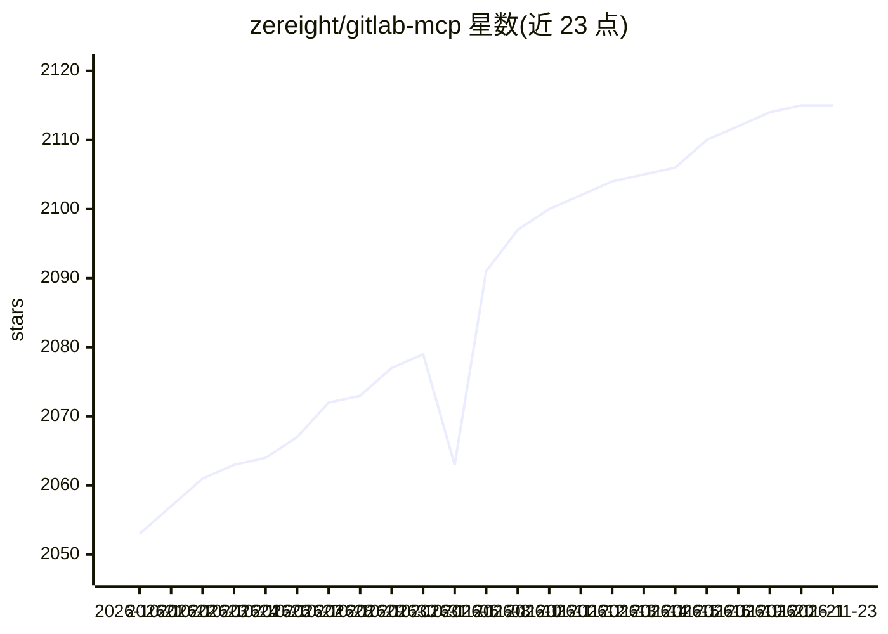

# zereight/gitlab-mcp

⭐ 2,115 · TypeScript · MIT · 推送 2026-11-22 · [GitHub](https://github.com/zereight/gitlab-mcp) · [官网](https://zereight.github.io/gitlab-mcp/) · 个人维护

**给 AI 客户端接入 GitLab 的 MCP 服务器，提供 290 个工具**

一个 GitLab MCP 服务器，通过 GitLab REST/GraphQL API 提供项目、合并请求、issue、流水线、wiki、发布等 290 个工具，支持 stdio、SSE 和 Streamable HTTP 传输。默认仅加载 40 个核心工具以控制 token 开销，可通过 discover_tools 按需激活类别；提供 Skill + CLI 的非 MCP 使用路径；支持 PAT、本地 OAuth2、MCP OAuth 代理与远程授权四种认证方式。面向使用 Claude Code、Cursor、VS Code 等 MCP 客户端的开发者。需 Node.js >=20。

## 筛选速览

| 维度 | 判定 | 备注 |
|---|---|---|
| AI 角色 | `ai-ecosystem` | LLM/agent 周边工具 |
| 许可风险 | `permissive` | MIT |
| 部署形态 | `desktop` | 安装包/桌面程序 |
| 模型依赖 | — | README 未给出锁定关系 |
| 硬件要求 | — | 无带数字的原话,不猜 |
| 安装摩擦 | `low` | 无编译、无系统依赖或容器化 |
| 成熟度 | — | 结构信号不足 |

## 能力要点

- 290 个工具覆盖项目、MR、issue、流水线、wiki、发布等
- 默认 40 个核心工具，discover_tools 按需激活以控制 schema token
- 四种认证方式：PAT、本地 OAuth2、MCP OAuth 代理、远程授权
- 内置 Agent Skill 与 CLI，可不注册 MCP 直接在终端使用

## 适用场景

- 让 Claude Code / Cursor 等 AI 客户端直接操作 GitLab 的 MR、issue 与流水线
- 团队通过远程 HTTP 部署共享的 GitLab MCP 服务
- 在终端用 CLI 查看 MR 完整 diff 与 job 日志

## 场景标签

 · 领域:开发者工具/LLM 基础设施

## 证据(README 行号)

> L139: **Agent-workflow-optimized GitLab MCP** — manage projects, merge requests, issues, pipelines, wiki, releases, tags
> L145: - **Default 40 tools (38 `core` + `discover_tools` + `help`); 290 total** — start lean; call `discover_tools` to a
> L150: - **Client-friendly setup** — examples for Claude Code, Codex, Antigravity, OpenCode, Copilot, Cline, Roo Code, Cu

## 星数曲线

2026-10-21 2,053 → 2026-11-23 2,115（+62）

---
*卡片 v1 · prompt 1.4 · 生成 2026-11-23 · 置信度 mid · 依据 README sha `38f2f756b758` · [字段定义](../../DATASET.md)*
