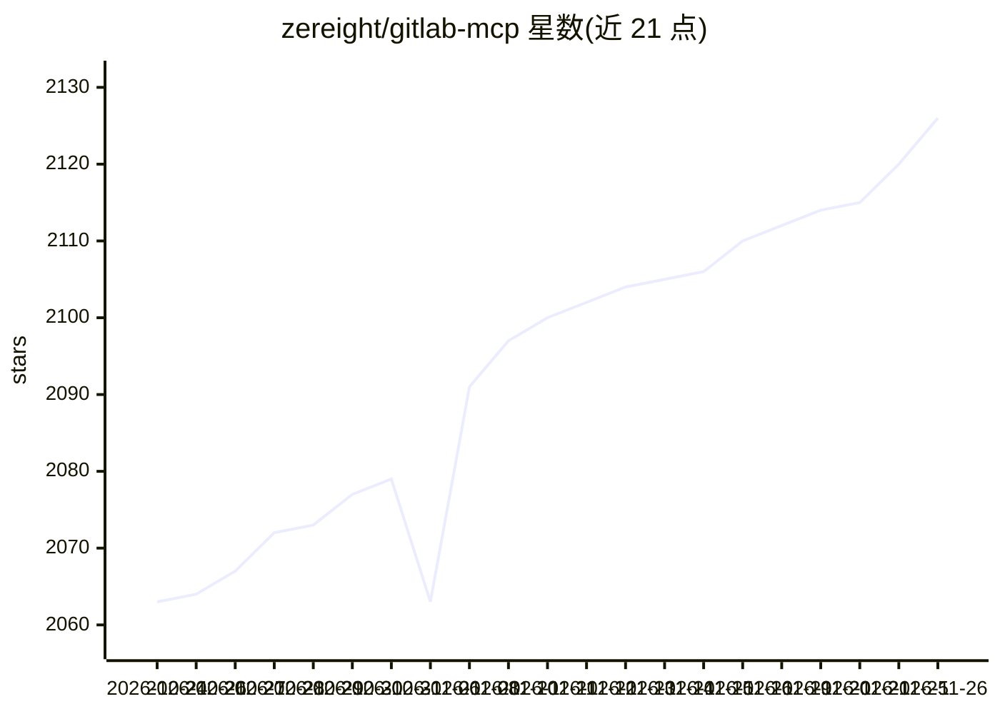

# zereight/gitlab-mcp

⭐ 2,126 · TypeScript · MIT · 推送 2026-11-25 · [GitHub](https://github.com/zereight/gitlab-mcp) · [官网](https://zereight.github.io/gitlab-mcp/) · 个人维护 · 中文 README

**面向 AI agent 的 GitLab MCP 服务器（290 个工具）**

连接 GitLab REST/GraphQL API 的 MCP 服务器，管理项目、合并请求、issues、流水线、wiki、发布、标签、里程碑等。默认仅加载约 40 个核心工具以控制 token 开销，通过 discover_tools 按会话激活更多类别；支持 stdio/SSE/Streamable HTTP 三种传输、PAT/本地 OAuth2/MCP OAuth/远程授权四种认证，附带 CLI 路径（无需 MCP 注册）与 JMESPath 结果过滤，需 Node.js >=20。

## 筛选速览

| 维度 | 判定 | 备注 |
|---|---|---|
| AI 角色 | `ai-ecosystem` | LLM/agent 周边工具 |
| 许可风险 | `permissive` | MIT |
| 部署形态 | `desktop` | 安装包/桌面程序 |
| 模型依赖 | — | README 未给出锁定关系 |
| 硬件要求 | — | 无带数字的原话,不猜 |
| 安装摩擦 | `low` | 无编译、无系统依赖或容器化 |
| 成熟度 | — | 结构信号不足 |

## 能力要点

- 290 个工具，默认 40 个按需发现激活，控制上下文 token 开销
- 四种认证方式：PAT、本地 OAuth2、MCP OAuth 代理、远程授权
- stdio/SSE/Streamable HTTP 三种传输，支持自托管 GitLab
- Skill + CLI 等效路径，可在终端全量输出 diff 与日志

## 适用场景

- 在 IDE 中让 AI agent 读取合并请求 diff 并辅助代码评审
- 通过自然语言查询流水线日志与分页作业输出
- 团队托管部署下多用户各自携带 PAT 访问 GitLab

## 场景标签

`代码审查` · 领域:编码与开发

## 证据(README 行号)

> L139: **Agent-workflow-optimized GitLab MCP** — manage projects, merge requests, issues, pipelines, wiki, releases, tags
> L149: - **Multiple transports** — stdio for local clients, SSE for legacy clients, and Streamable HTTP for modern remote
> L20: **Default: 40 tools** (38 `core` + `discover_tools` + `help`). 290 tools exist in total (287 in toolsets + `execute

## 星数曲线

2026-10-24 2,063 → 2026-11-26 2,126（+63）

---
*卡片 v1 · prompt 1.4 · 生成 2026-11-24 · 置信度 mid · 依据 README sha `d727dca04b5e` · [字段定义](../../DATASET.md)*
