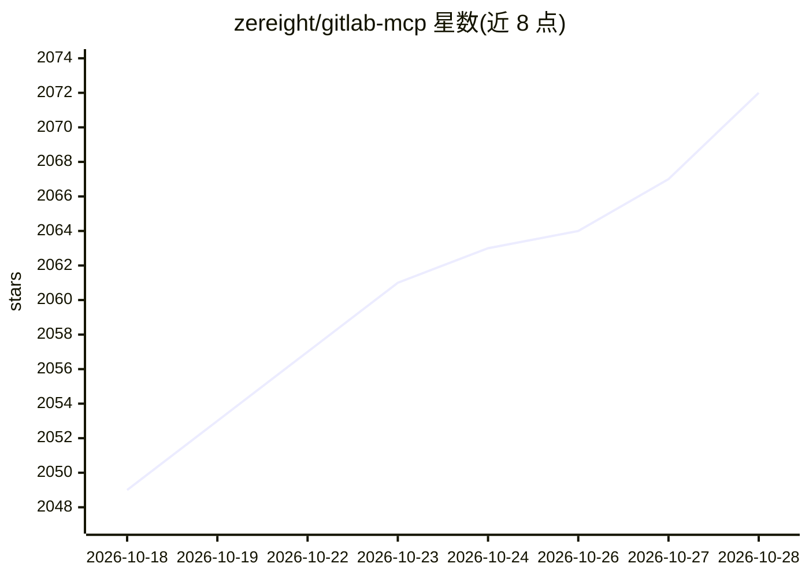

# zereight/gitlab-mcp

⭐ 2,073 · TypeScript · MIT · 推送 2026-10-28 · [GitHub](https://github.com/zereight/gitlab-mcp) · [官网](https://zereight.github.io/gitlab-mcp/) · 个人维护 · 中文 README

**面向 AI agent 工作流的 GitLab MCP 服务器（276 个工具）**

通过 GitLab REST/GraphQL API 为 MCP 客户端提供项目、合并请求、issue、流水线、wiki、发布、里程碑等管理能力的 MCP 服务器，共 276 个工具（274 个按 toolset 组织，另有 execute_graphql 与 discover_tools）。支持 stdio/SSE/Streamable HTTP 三种传输，认证方式含 PAT、本地 OAuth2 浏览器流、MCP OAuth 代理与按请求远程授权，兼容自建 GitLab 实例与动态 API URL。以 npm/Homebrew/Nix 安装，Claude Desktop 有一键 MCP Bundle；README 含与社区版及 GitLab 官方 MCP 服务器的对比表。

## 筛选速览

| 维度 | 判定 | 备注 |
|---|---|---|
| AI 角色 | `ai-ecosystem` | LLM/agent 周边工具 |
| 许可风险 | `permissive` | MIT |
| 部署形态 | `self-host` | docker 或自建部署 |
| 模型依赖 | — | README 未给出锁定关系 |
| 硬件要求 | — | 无带数字的原话,不猜 |
| 安装摩擦 | `low` | 无编译、无系统依赖或容器化 |
| 成熟度 | — | 结构信号不足 |

## 能力要点

- 276 个工具按 toolset 组织，运行时可按需激活
- MR 两步审查流程（列出变更文件→批量获取 diff）
- stdio/SSE/Streamable HTTP 三种传输与四种认证方式
- 支持自建 GitLab 实例、代理设置与 JMESPath 结果过滤

## 适用场景

- 让 Claude/Cursor/VS Code 等 MCP 客户端直接操作 GitLab 项目与合并请求
- AI agent 工作流中管理 issue、流水线与 wiki
- 多用户远程部署时按请求提供各自 token

## 场景标签

 · 领域:开发工具/AI Agent 基础设施

## 证据(README 行号)

> L38: **Agent-workflow-optimized GitLab MCP** — manage projects, merge requests, issues, pipelines, wiki, releases, tags,
> L44: - **276 tools: 274 in toolsets + `execute_graphql` + `discover_tools`** — start with a small toolset; activate more

## 星数曲线

2026-10-18 2,049 → 2026-10-28 2,072（+23）

---
*卡片 v1 · prompt 1.4 · 生成 2026-10-21 · 置信度 mid · 依据 README sha `957edc4429bd` · [字段定义](../../DATASET.md)*
