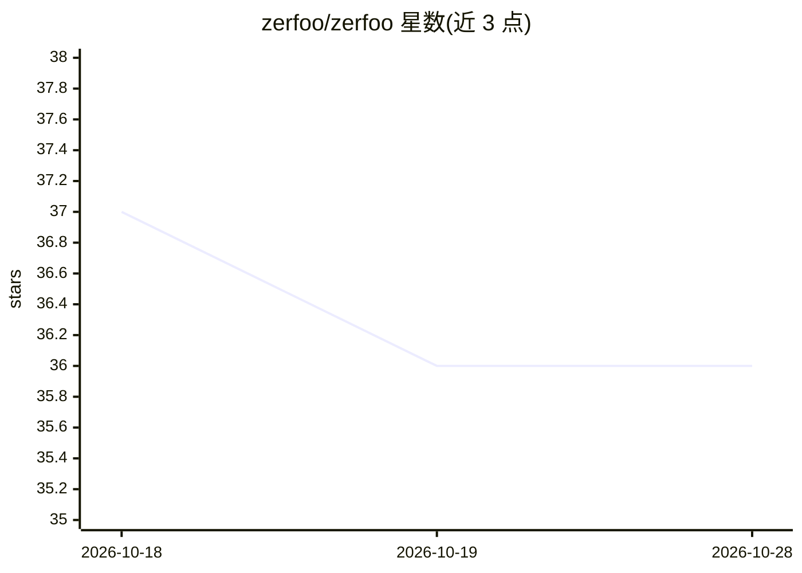

# zerfoo/zerfoo

⭐ 36 · Go · Apache-2.0 · 推送 2026-10-14 · [GitHub](https://github.com/zerfoo/zerfoo) · [官网](https://zer.foo) · 组织维护

**纯 Go 机器学习框架：训练、推理与模型服务，零 CGo**

用 Go 编写的 ML 框架，支持加载与推理 GGUF 模型（38 个模型构建器覆盖 45 种架构字符串）、训练及 OpenAI 兼容 API 服务。面向希望在 Go 应用中嵌入 ML 能力的开发者。关键机制：默认内存映射 GGUF 文件使可运行超过内存容量的模型；CUDA 经 dlopen 而非 CGo 接入，默认与发布构建零 CGo。限制：基准为单机单配置且未做质量归一化（Q4_K 重量化为 Q4_0）；EAGLE 投机解码已实现但未接入生成路径。

## 筛选速览

| 维度 | 判定 | 备注 |
|---|---|---|
| AI 角色 | `ai-ecosystem` | LLM/agent 周边工具 |
| 许可风险 | `permissive` | Apache-2.0 |
| 部署形态 | `library` | 以包/库形式分发 |
| 模型依赖 | — | README 未给出锁定关系 |
| 硬件要求 | — | 无带数字的原话,不猜 |
| 安装摩擦 | `medium` | 含编译或系统依赖之一 |
| 成熟度 | `idea` | |

## 能力要点

- 内存映射加载 GGUF，可在 128 GB 机器上运行 229B（128.8 GB）模型
- 默认/发布构建零 CGo，GPU 经 dlopen/dlsym 运行时接入
- 量化与三级 KV 缓存、Multi-LoRA 服务、BitNet 三元推理、Whisper/Voxtral 语音转录
- 内置表格 ML 与时间序列预测

## 适用场景

- 在 Go 应用中直接嵌入并运行 GGUF 大模型
- 通过 OpenAI 兼容 API 服务多个 LoRA 适配器
- 内存受限机器上运行超过 RAM 容量的大模型

## 场景标签

`模型训练` `推理引擎` `语音识别` · 领域:感知与多模态

## 证据(README 行号)

> L3: Pure Go ML framework -- inference, training, and serving. Embed any GGUF model in your Go application with `go build
> L10: **235 tok/s** on Gemma 3 1B Q4_K_M -- 1.25x Ollama 0.17.7 on an NVIDIA DGX Spark GB10, at parity by 3B. Zero CGo in

## 星数曲线

2026-10-18 37 → 2026-10-28 36（-1）

---
*卡片 v1 · prompt 1.4 · 生成 2026-10-25 · 置信度 high · 依据 README sha `3da06ee0779e` · [字段定义](../../DATASET.md)*
