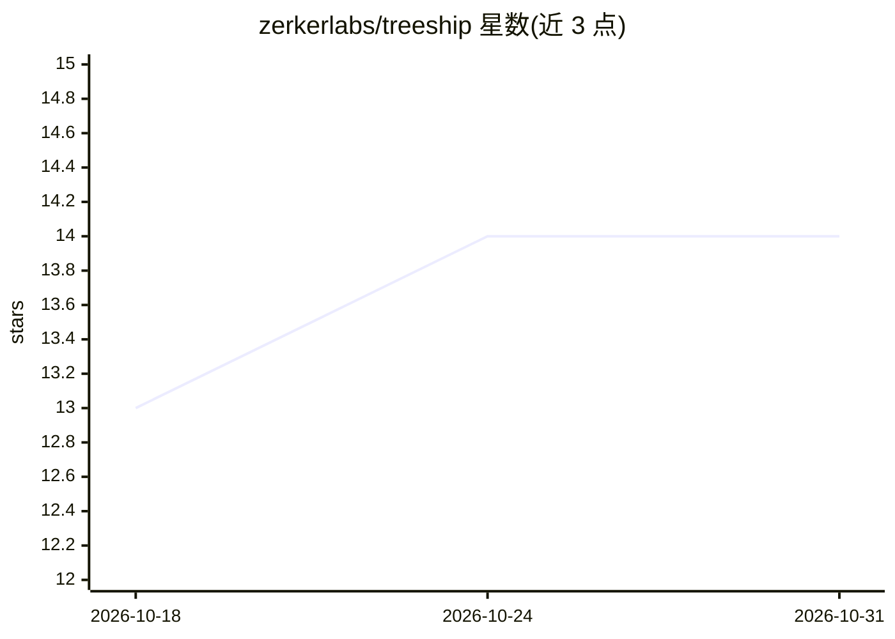

# zerkerlabs/treeship

⭐ 14 · Rust · Apache-2.0 · 推送 2026-10-29 · [GitHub](https://github.com/zerkerlabs/treeship) · [官网](https://treeship.dev) · 组织维护

**为 AI agent 行动生成签名可验证收据的信任层工具**

开源信任层：把 agent 的动作捕获为 Ed25519 签名、带时间戳的可移植工件，绑定 per-agent 密钥与能力卡，通过哈希链与 Merkle 检查点保证完整性。本地捕获无需服务器，发布是独立的显式步骤；每个验证方用自己固定的信任根离线验证，并诚实区分 asserted 与 proven 身份证明。提供 CLI（npm/GitHub Releases 分发，macOS/Linux 静态二进制，Windows 需 WSL）、TypeScript/Python SDK、WASM 验证包、MCP/A2A 桥及 Claude Code 插件。

## 筛选速览

| 维度 | 判定 | 备注 |
|---|---|---|
| AI 角色 | `ai-ecosystem` | LLM/agent 周边工具 |
| 许可风险 | `permissive` | Apache-2.0 |
| 部署形态 | `library` | 以包/库形式分发 |
| 模型依赖 | — | README 未给出锁定关系 |
| 硬件要求 | — | 无带数字的原话,不猜 |
| 安装摩擦 | `low` | 无编译、无系统依赖或容器化 |
| 成熟度 | — | 结构信号不足 |

## 能力要点

- 包装任意命令即产出签名收据，离线验证签名/链完整性/审批绑定
- agent 身份登记（onboard）后动作验证为 proven (key-bound)，支持选择性披露的 presentation
- 单次范围化人类审批（attest approval），重放被拒绝
- 按验证面区分能证明与不能证明的内容，CLI 输出各表面验证范围

## 适用场景

- 为 agent 的部署、代码执行等动作留下可离线验证的签名凭证
- 在 PR 中附收据并用 verify-receipts action 强制验证
- 两方之间离线握手验证 agent 的证书链与能力（含 challenge）
- 为 MCP 通信的 agent 生成签名收据

## 场景标签

 · 领域:AI agent 基础设施/可验证性

## 证据(README 行号)

> L13: Treeship is an open-source trust layer that records agent actions as signed artifacts,
> L230: |`@treeship/mcp`|npm|`bridges/mcp/`|MCP bridge — signed receipts for any MCP-speaking agent|

## 星数曲线

2026-10-18 13 → 2026-10-31 14（+1）

---
*卡片 v1 · prompt 1.4 · 生成 2026-10-31 · 置信度 high · 依据 README sha `6b5576a924fc` · [字段定义](../../DATASET.md)*
